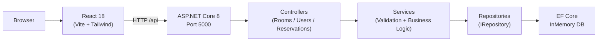
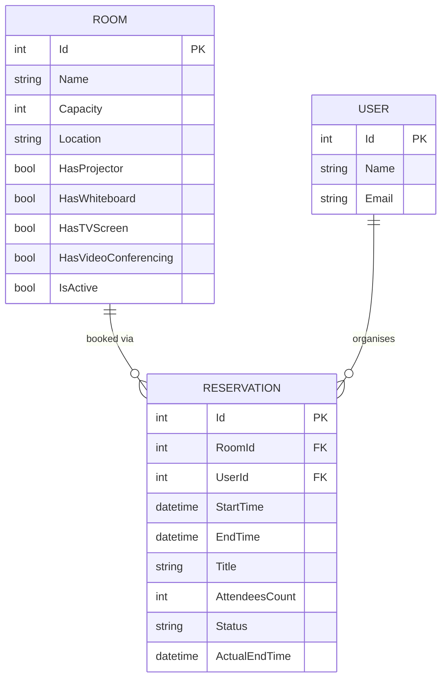

# Room Reservation System - Conflict-Free Meeting Room Booking

A full-stack ASP.NET Core 8 + React application that enforces booking rules server-side, prevents double-bookings, and provides a clean booking experience for teams.


## Overview

The system allows users to book meeting rooms across multiple floors, enforcing seven server-side booking rules (R1-R7) that prevent double-bookings, capacity violations, and horizon breaches. A React SPA communicates with the ASP.NET Core 8 REST API over a Vite proxy, with all data persisted in an EF Core InMemory database (per task scope).

## System Architecture



## Entity Relationship Diagram



## Features

- **R1-R7 validation** - seven booking rules enforced server-side in a single `ValidateAsync` method
- **Room conflict detection** - half-open interval overlap check prevents double-bookings
- **Organiser conflict detection** - prevents the same user from being in two places at once
- **Early completion** - `PATCH /reservations/{id}/complete` records `ActualEndTime` and frees the room slot
- **Usage report** - per-room scheduled vs actual hours and utilisation percentage
- **Configurable limits** - `MaxDurationDays` (7) and `MaxBookingHorizonDays` (90) via `appsettings.json`
- **Concurrency guard** - static `SemaphoreSlim` serialises all write operations
- **19 unit tests** - boundary tests, lifecycle tests, and all seven validation rules covered

## Tech Stack

| Layer | Technology |
|---|---|
| Backend framework | ASP.NET Core 8 Web API (controllers pattern) |
| ORM / database | EF Core 8 InMemory provider |
| Frontend framework | React 18 |
| Build tool | Vite 5 |
| CSS | Tailwind CSS v4 (via `@tailwindcss/vite`) |
| HTTP client | Axios |
| Routing | React Router DOM v6 |
| Test framework | xUnit |
| API docs | Swagger / Swashbuckle |

## Quick Start

**Prerequisites:** .NET 8 SDK, Node.js 18+

**1. Clone the repository**
```bash
git clone https://github.com/Amith-Ganta/room-reservation-system.git
cd room-reservation-system
```

**2. Start the API**
```bash
cd backend/RoomReservation.API
dotnet run
```
API starts on `http://localhost:5000`. Swagger UI at `http://localhost:5000/swagger`.

**3. Start the frontend**
```bash
cd frontend
npm install
npm run dev
```
React app starts on `http://localhost:5173`. The Vite proxy forwards `/api` to port 5000.

**4. Run the tests**
```bash
cd backend/RoomReservation.Tests
dotnet test
```
Expected output: 19 passed, 0 failed.

**5. Demo data**
The API seeds five rooms, three users, and two upcoming reservations on first run.

## Booking Rules

| Rule | Description | Error Code |
|---|---|---|
| R1 | Start must be before end; duration cannot exceed 7 days | `R1_MAX_DURATION` |
| R2 | Room cannot be double-booked (half-open interval overlap) | `R2_ROOM_CONFLICT` |
| R3 | Organiser cannot have two overlapping bookings | `R3_ORGANIZER_CONFLICT` |
| R4 | Start time must be in the future | `R4_FUTURE_ONLY` |
| R5 | Attendee count cannot exceed room capacity | `R5_CAPACITY_EXCEEDED` |
| R6 | Start cannot be more than 90 days in the future | `R6_BOOKING_HORIZON` |
| R7 | Room must be active | `R7_ROOM_INACTIVE` |

Limits are configurable in `appsettings.json` under the `Reservation` key.

## API Summary

| Method | Path | Purpose |
|---|---|---|
| GET | `/api/rooms` | List rooms (filterable by capacity, amenities, floor) |
| POST | `/api/rooms` | Create a room |
| PUT | `/api/rooms/{id}` | Update a room |
| DELETE | `/api/rooms/{id}` | Delete a room |
| GET | `/api/users` | List users |
| POST | `/api/users` | Create a user |
| PUT | `/api/users/{id}` | Update a user |
| DELETE | `/api/users/{id}` | Delete a user |
| GET | `/api/reservations` | List reservations (filterable by room, user, status, date range) |
| POST | `/api/reservations` | Create a reservation (R1-R7 enforced) |
| PUT | `/api/reservations/{id}` | Update a reservation (R1-R7 re-enforced) |
| PATCH | `/api/reservations/{id}/cancel` | Cancel a reservation |
| PATCH | `/api/reservations/{id}/complete` | End a reservation early (sets ActualEndTime) |
| GET | `/api/reservations/usage-report` | Room utilisation report |
| DELETE | `/api/reservations/{id}` | Delete a reservation |

Full request/response examples: [docs/API.md](docs/API.md)

## Known Limitations

See [docs/KNOWN_LIMITATIONS.md](docs/KNOWN_LIMITATIONS.md) for the full list. Key items: data is lost on restart (InMemory), no authentication, concurrency guard is single-process only.

## Documentation

| Document | Purpose |
|---|---|
| [docs/ARCHITECTURE.md](docs/ARCHITECTURE.md) | Layered architecture, request sequence, state lifecycle, concurrency model |
| [docs/API.md](docs/API.md) | All endpoints, error codes, example requests |
| [docs/DECISIONS.md](docs/DECISIONS.md) | 8 architecture decision records |
| [docs/KNOWN_LIMITATIONS.md](docs/KNOWN_LIMITATIONS.md) | 7 documented limitations with mitigation paths |
| [docs/CONTRIBUTING.md](docs/CONTRIBUTING.md) | How to run, test, and contribute |

## License

MIT - see [LICENSE](LICENSE)
