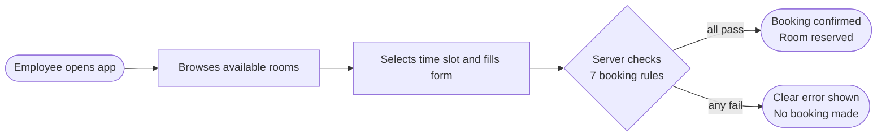
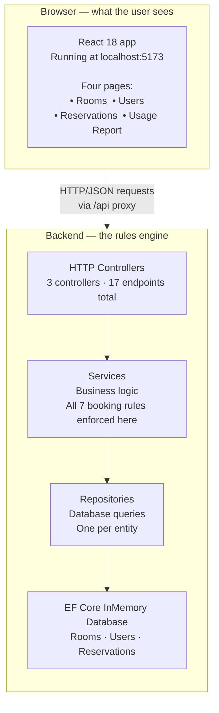
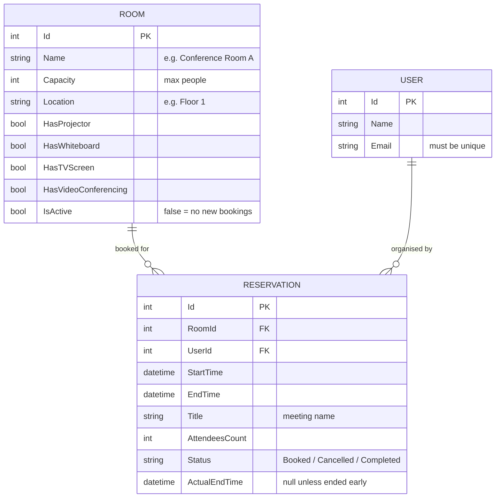
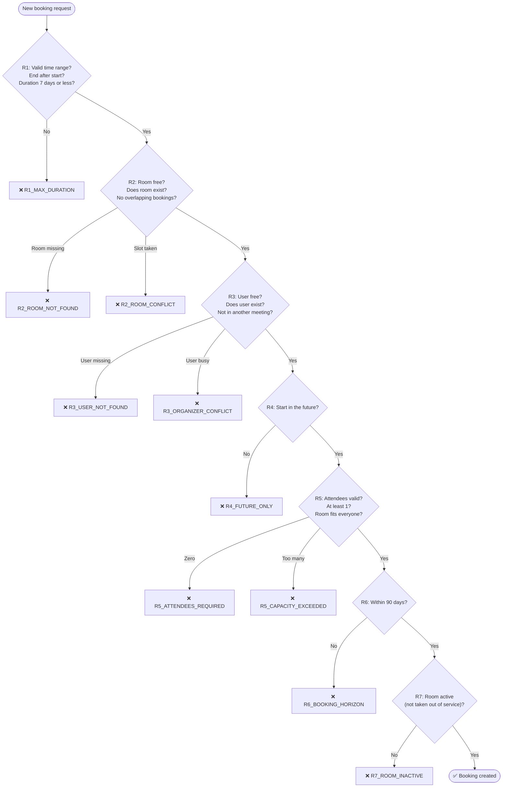
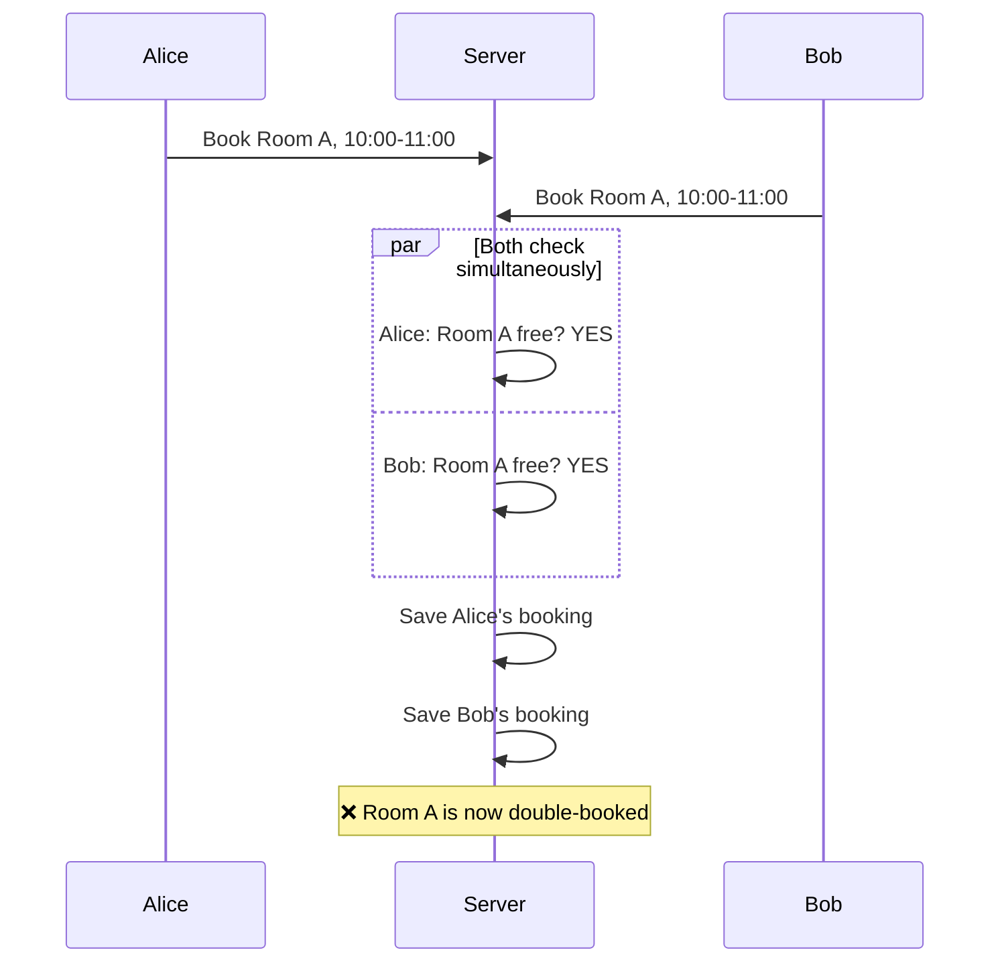
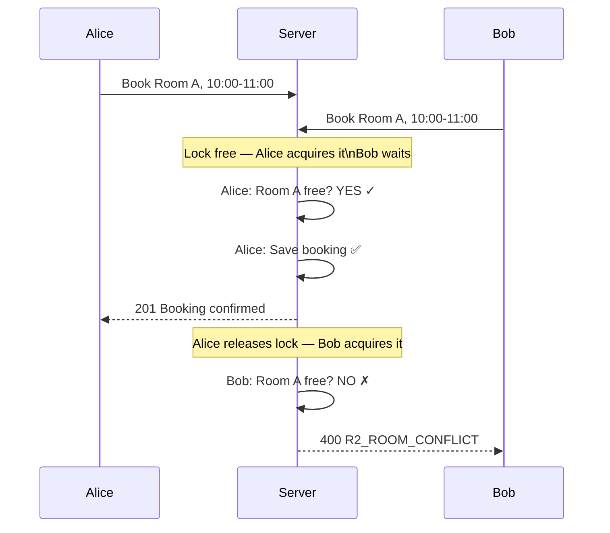
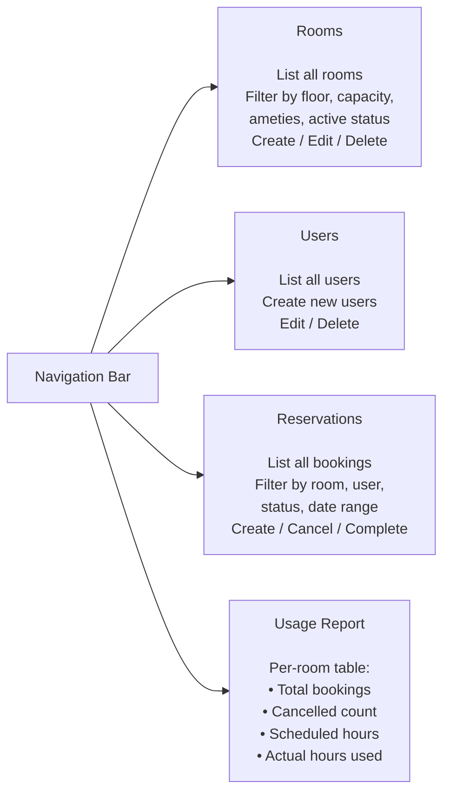
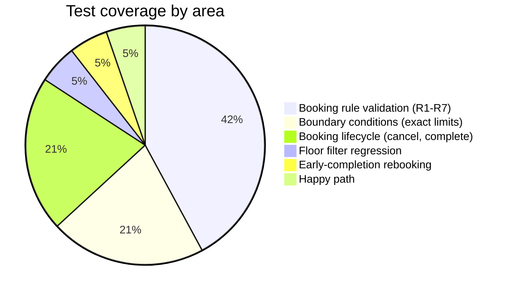
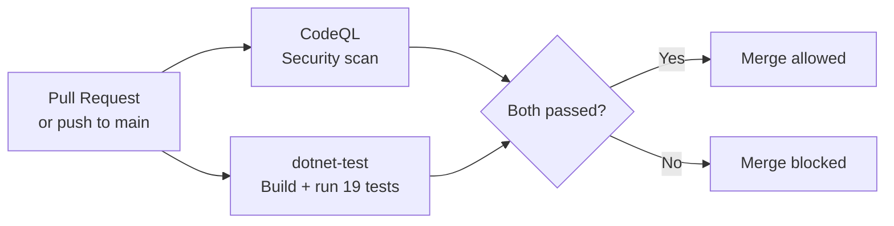

# Room Reservation System

**A full-stack web application for booking meeting rooms — with conflict prevention, business rules, and a live usage report.**


---

## What this system does

Imagine your company has five meeting rooms. Right now, people book them by sending a Slack message, adding a calendar event, or walking over to a whiteboard. Two people accidentally book the same room at the same time. Nobody knows which rooms have a projector until they arrive.

This system solves that. It is a web application — a backend API and a React frontend — that lets employees:

- Browse available rooms and filter by what they need (projector, capacity, floor)
- Book a room for a specific time slot
- Cancel a booking if plans change
- Mark a meeting as ended early, which immediately releases the room for someone else
- See a usage report showing which rooms are being used and for how long

The system enforces rules automatically. You cannot book a room for longer than 7 days. You cannot book a slot that is already taken. You cannot invite more people than the room holds. These rules are not just UI warnings — they are enforced at the server level, so no workaround through the API can bypass them.

---

## How a booking works — for non-technical readers



---

## The life of a single booking

```mermaid
stateDiagram-v2
    [*] --> Booked : Employee submits booking\n(all 7 rules pass)
    Booked --> Cancelled : Employee cancels\n(room freed immediately)
    Booked --> Completed : Meeting ends early\nPATCH complete called\n(room freed at actual end time)
    Booked --> Completed : Meeting runs to schedule\n(room freed at original end time)
    Cancelled --> [*] : Slot available for rebooking
    Completed --> [*] : Slot available for rebooking\nfrom actual end time
```



---

## System architecture — how the pieces connect



**Backend:** ASP.NET Core 8 Web API, written in C#. Handles all business rules — validation, conflict detection, usage reporting.

**Frontend:** React 18 with Vite and Tailwind CSS. Four pages: Rooms, Users, Reservations, Usage Report.

**Database:** EF Core InMemory (in-process dictionary). Data resets on restart. Suitable for demo and review; swap to SQLite or SQL Server with one line change.

---

## What is stored



`ActualEndTime` is the field that makes early completion work. When a meeting ends 30 minutes early and someone marks it complete, this field records the real end time. The conflict-check engine then uses it as the room's release time, not the originally scheduled end. A room scheduled until noon but completed at 11:30 is immediately available for an 11:30 booking.

---

## The 7 booking rules — checked in this exact order



Rules run in this order deliberately. R2 (room lookup) runs before R4 (future-only check) because a request for a non-existent room should fail on "room not found" — the root cause — not on "past start time", which is a secondary issue. The first error a user sees should name the actual problem.

---

## The concurrency problem — and the fix

Without protection, two people submitting the same booking at exactly the same second can both pass the conflict check before either one saves, producing a double-booking.



The fix is a write lock — one request waits while the other finishes:



---

## What the frontend looks like



---

## Quick start

**Prerequisites:** .NET 8 SDK, Node.js 18+

**Clone**
```bash
git clone https://github.com/Amith-Ganta/room-reservation-system.git
cd room-reservation-system
```

**Start the API** (Terminal 1)
```bash
cd backend/RoomReservation.API
dotnet run
```
API starts at `http://localhost:5000`. Swagger UI (interactive API docs) at `http://localhost:5000/swagger`.

**Start the frontend** (Terminal 2)
```bash
cd frontend
npm install
npm run dev
```
App opens at `http://localhost:5173`. Both processes must be running at the same time.

**Run the tests**
```bash
cd backend/RoomReservation.Tests
dotnet test
```
Expected: 19 passed, 0 failed, 0 skipped.

On first run the API seeds five rooms, three users, and two upcoming reservations so the demo starts from a known, useful state.

---

## What the seed data looks like

| Room | Floor | Capacity | Projector | Whiteboard | TV | Video |
|------|-------|----------|-----------|------------|-----|-------|
| Conference Room A | Floor 1 | 10 | yes | yes | no | no |
| Board Room | Floor 2 | 20 | yes | yes | yes | yes |
| Small Meeting Room | Floor 1 | 4 | no | yes | no | no |
| Training Room | Floor 3 | 30 | yes | no | yes | no |
| Huddle Space | Floor 2 | 6 | no | no | yes | no |

| User | Email |
|------|-------|
| Alice Johnson | alice@example.com |
| Bob Smith | bob@example.com |
| Carol White | carol@example.com |

---

## Test suite — 19 tests, 0 failures



| # | Test | What it proves |
|---|------|----------------|
| 1 | R1_StartMustBeBeforeEnd | start >= end returns R1 error |
| 2 | R1_DurationCannotExceedMax | 8-day booking returns R1 error |
| 3 | R2_RoomConflict | Overlapping booking on same room returns R2 |
| 4 | R3_OrganizerConflict | Same user, different room, overlapping slot returns R3 |
| 5 | R4_StartMustBeInFuture | Past start time returns R4 error |
| 6 | R5_CapacityExceeded | 10 attendees in 5-seat room returns R5 error |
| 7 | R6_BookingHorizonExceeded | Start 100 days out returns R6 error |
| 8 | R7_InactiveRoom | Booking inactive room returns R7 error |
| 9 | ValidReservation_CreatesSuccessfully | Valid request creates booking, status=Booked |
| 10 | Cancel_ChangesStatusToCancelled | CancelAsync sets status to Cancelled |
| 11 | CancelledSlot_AllowsNewBooking | New booking into a cancelled slot succeeds |
| 12 | Complete_BeforeStartTime_ReturnsError | Complete on not-yet-started meeting returns INVALID_STATUS |
| 13 | Complete_AlreadyStarted_RecordsActualEndTime | Complete sets ActualEndTime <= EndTime |
| 14 | R1_ExactlyMaxDurationDays_Succeeds | 7-day booking (exactly the limit) succeeds |
| 15 | R1_OneDayOverMaxDuration_Fails | 8-day booking fails |
| 16 | R6_ExactlyHorizonDays_Succeeds | Booking at exactly 90 days out succeeds |
| 17 | R6_HorizonPlusOneHour_Fails | Booking at 90 days + 1 hour fails |
| 18 | GetFilteredAsync_FloorFilter_IsCaseInsensitive | Query "floor 1" finds room at "Floor 1" |
| 19 | EarlyCompletion_AllowsRebook | After early completion, same slot accepts a new booking |

Tests 14-17 are boundary tests: they verify both sides of both configurable limits. A test that only checks "8 days fails" does not tell you whether 7 days succeeds. Test 19 is the most important — it exercises the full chain of the early-completion design, from completing a booking early through to confirming a new booking can be placed at that released time.

---

## CI pipeline



A pull request that breaks any test cannot merge.

---

## API — all 17 endpoints

| Method | Path | What it does |
|--------|------|-------------|
| GET | `/api/rooms` | List rooms — filter by capacity, floor, amenities, active status |
| GET | `/api/rooms/{id}` | Get one room |
| POST | `/api/rooms` | Create a room |
| PUT | `/api/rooms/{id}` | Update a room |
| DELETE | `/api/rooms/{id}` | Delete a room |
| GET | `/api/users` | List all users |
| GET | `/api/users/{id}` | Get one user |
| POST | `/api/users` | Create a user |
| PUT | `/api/users/{id}` | Update a user |
| DELETE | `/api/users/{id}` | Delete a user |
| GET | `/api/reservations` | List reservations — filter by room, user, status, date range |
| GET | `/api/reservations/{id}` | Get one reservation |
| POST | `/api/reservations` | Create a reservation (R1-R7 enforced) |
| PUT | `/api/reservations/{id}` | Update a reservation (R1-R7 re-enforced) |
| PATCH | `/api/reservations/{id}/cancel` | Cancel a reservation |
| PATCH | `/api/reservations/{id}/complete` | End a reservation early, sets ActualEndTime |
| GET | `/api/reservations/usage-report` | Per-room hours and booking counts |

Every error response has the same shape:
```json
{
  "error": "R2_ROOM_CONFLICT",
  "message": "Room 3 is already booked from 10:00 to 11:00."
}
```

Full curl examples and JSON shapes: [docs/API.md](docs/API.md)

---

## Tech stack

| Layer | Technology |
|-------|-----------|
| Backend | ASP.NET Core 8 Web API |
| ORM / database | EF Core 8 InMemory |
| Frontend | React 18 |
| Build tool | Vite 5 |
| CSS | Tailwind CSS v4 |
| HTTP client | Axios |
| Routing | React Router DOM v6 |
| Tests | xUnit |
| API docs | Swagger / Swashbuckle |
| CI | GitHub Actions (CodeQL + dotnet-test) |

---

## Known limitations

The system is complete as a demonstration. Three things would need to change before production:

| Limitation | Why it exists | How to fix it |
|------------|--------------|---------------|
| Data resets on restart | EF Core InMemory has no disk persistence | Swap `UseInMemoryDatabase` for `UseSqlite` or `UseSqlServer`, add migrations |
| No authentication | Out of scope for this submission | Add JWT bearer middleware; user identity from token, not request body |
| Concurrency guard is single-process only | InMemory has no transaction isolation; a process-level lock is the strongest available | Switch to a real database and use a serialisable transaction instead |

Full list with migration paths: [docs/KNOWN_LIMITATIONS.md](docs/KNOWN_LIMITATIONS.md)

---

## Documentation

| Document | What it covers |
|----------|---------------|
| [docs/ARCHITECTURE.md](docs/ARCHITECTURE.md) | Layer diagram, request sequence, state machine, concurrency model |
| [docs/API.md](docs/API.md) | All 17 endpoints with curl examples, JSON shapes, error code tables |
| [docs/DECISIONS.md](docs/DECISIONS.md) | 8 architecture decision records — what was chosen and why |
| [docs/KNOWN_LIMITATIONS.md](docs/KNOWN_LIMITATIONS.md) | 7 limitations with mitigation paths |
| [docs/CONTRIBUTING.md](docs/CONTRIBUTING.md) | Setup, test, branch, commit, PR checklist |
| [SUBMISSION_REPORT.md](SUBMISSION_REPORT.md) | Full submission report — deep technical walkthrough, all decisions, self-assessment |

---

## License

MIT — see [LICENSE](LICENSE)
