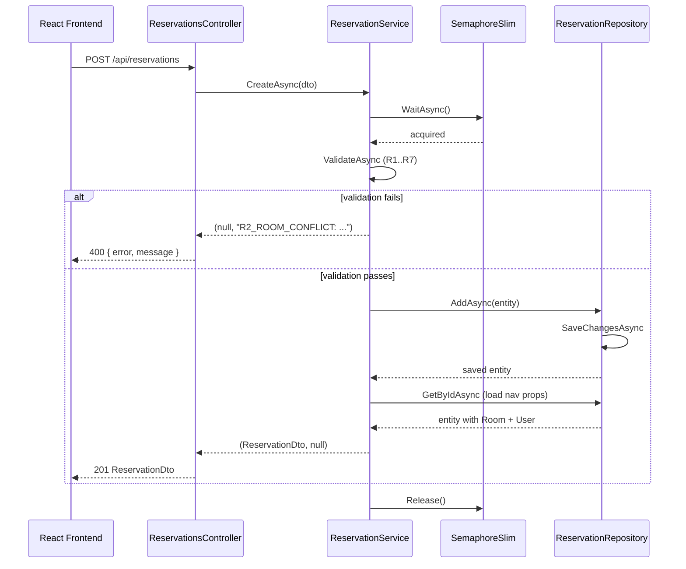
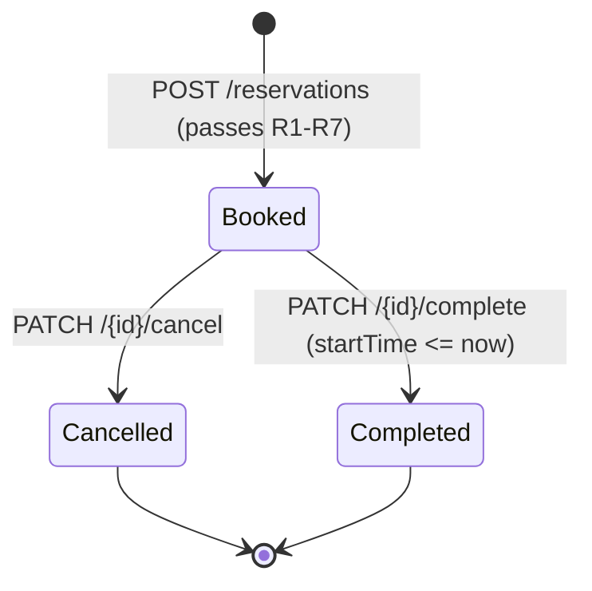
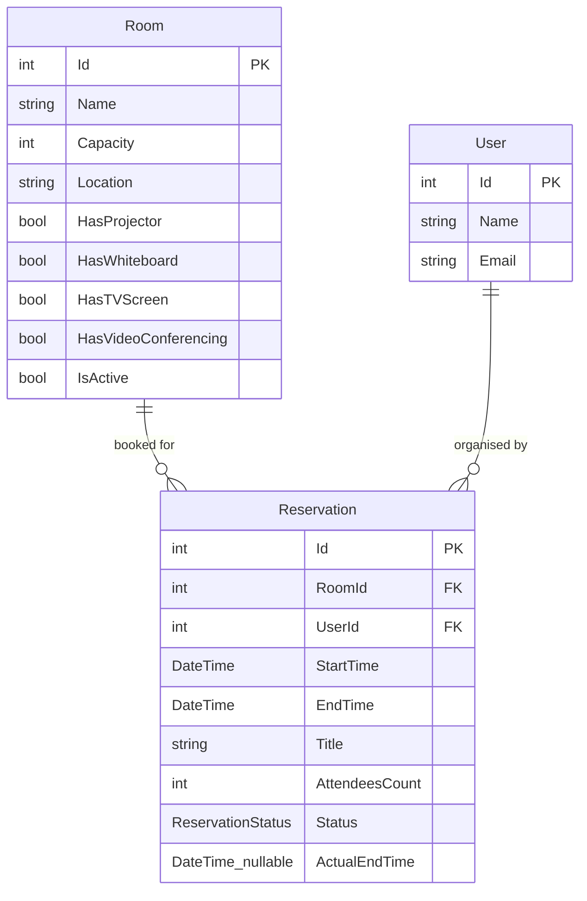
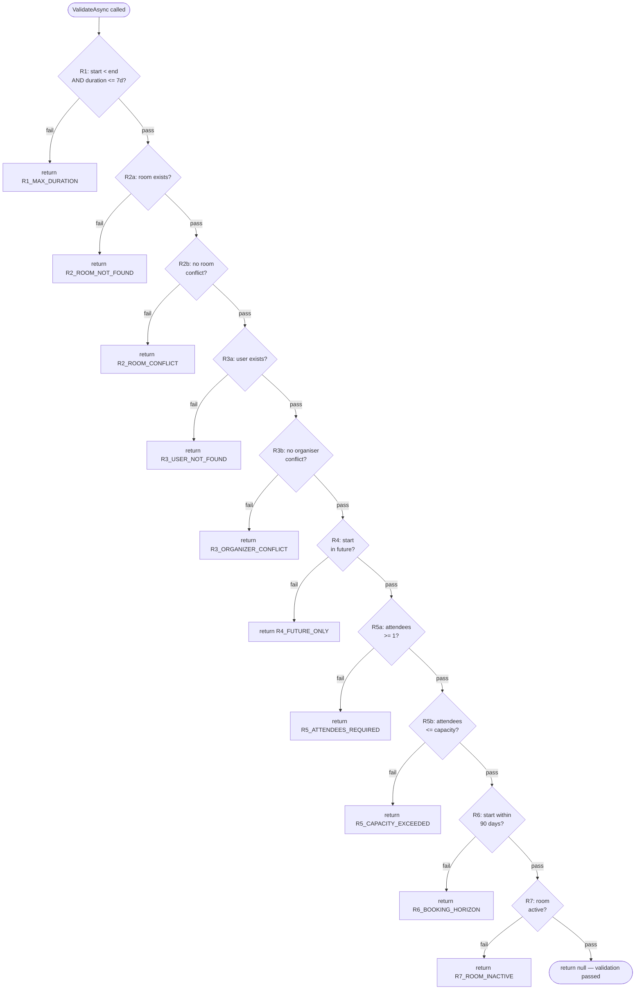

# Room Reservation System -- Submission Report

**Candidate:** Amith Ganta  
**Repository:** https://github.com/Amith-Ganta/room-reservation-system  
**Submission date:** 2025

---

## Table of contents

1. [Executive summary](#1-executive-summary)
2. [System architecture](#2-system-architecture)
3. [Data model](#3-data-model)
4. [API surface](#4-api-surface)
5. [Booking rules: design and enforcement](#5-booking-rules-design-and-enforcement)
6. [Concurrency model](#6-concurrency-model)
7. [Test suite](#7-test-suite)
8. [Frontend](#8-frontend)
9. [Configuration and deployment](#9-configuration-and-deployment)
10. [Architecture decision records](#10-architecture-decision-records)
11. [Known limitations and mitigation paths](#11-known-limitations-and-mitigation-paths)
12. [Response to review findings E-1 through E-5](#12-response-to-review-findings-e-1-through-e-5)
13. [Deployment roadmap](#13-deployment-roadmap)
14. [Self-assessment](#14-self-assessment)

---

## 1. Executive summary

This submission is a full-stack room reservation system built to specification. The backend is an ASP.NET Core 8 Web API that enforces seven booking rules, handles concurrent booking attempts without double-booking, and tracks early room releases with an audit timestamp. The frontend is a React 18 single-page application that exposes all API operations through four page views. The test suite is 19 xUnit unit tests covering every booking rule at its boundary.

The system was built in deliberate layers: HTTP controllers delegate to services, services delegate to repositories, validation is centralised in one method that both create and update paths share, and DTOs are separated from entity models via static mapper classes. None of these choices was incidental; each is documented in an ADR with its trade-off stated.

Five findings from the interim review (E-1 through E-5) were addressed before final submission. The most significant was E-4: a `Split(':')` call without a count limit, which would have corrupted error messages containing colons. The fix, a `Split(':', 2)` with an explicit maximum of two parts, is present in all eight reservation endpoint branches and both room-validation paths. The floor filter case-sensitivity regression introduced during the E-2 fix was also caught and corrected before submission.

---

## 2. System architecture

### Layer diagram

```
┌─────────────────────────────────────────────────────────┐
│  React 18 + Vite 5 (http://localhost:5173)              │
│  Rooms | Users | Reservations | Usage Report            │
│  axios client  ──  /api proxy  ──►  http://localhost:5000│
└─────────────────────────────────────────────────────────┘
          │ HTTP/JSON
          ▼
┌─────────────────────────────────────────────────────────┐
│  ASP.NET Core 8 Web API (http://localhost:5000)         │
│  ┌──────────────┐ ┌──────────────┐ ┌───────────────┐   │
│  │ RoomsCtrl    │ │ UsersCtrl    │ │ Reservations  │   │
│  │ 5 endpoints  │ │ 4 endpoints  │ │ Ctrl          │   │
│  └──────┬───────┘ └──────┬───────┘ │ 8 endpoints   │   │
│         │                │         └───────┬───────┘   │
│         ▼                ▼                 ▼           │
│  ┌──────────────┐ ┌──────────────┐ ┌───────────────┐   │
│  │ RoomService  │ │ UserService  │ │ Reservation   │   │
│  │              │ │              │ │ Service       │   │
│  └──────┬───────┘ └──────┬───────┘ └───────┬───────┘   │
│         │                │                 │           │
│         ▼                ▼                 ▼           │
│  ┌──────────────┐ ┌──────────────┐ ┌───────────────┐   │
│  │ RoomRepo     │ │ UserRepo     │ │ Reservation   │   │
│  │              │ │              │ │ Repo          │   │
│  └──────┬───────┘ └──────┬───────┘ └───────┬───────┘   │
│         └────────────────┴─────────────────┘           │
│                          │                             │
│                          ▼                             │
│             ┌────────────────────────┐                 │
│             │  AppDbContext          │                 │
│             │  EF Core InMemory      │                 │
│             │  "RoomReservationDb"   │                 │
│             └────────────────────────┘                 │
└─────────────────────────────────────────────────────────┘
```

### Request flow: booking creation



### Reservation lifecycle



---

## 3. Data model

### Entity relationship



### Model notes

**Room** has seven boolean amenity flags (`HasProjector`, `HasWhiteboard`, `HasTVScreen`, `HasVideoConferencing`) and `IsActive`. Rooms are never deleted by booking rule R7; instead they are marked `IsActive = false` to prevent new bookings while preserving the reservation history.

**User** stores name and email. Email is validated by `System.Net.Mail.MailAddress.TryCreate` at creation time and must be unique across all users.

**Reservation** carries `ActualEndTime` as a nullable `DateTime`. It is `null` for every reservation that was not explicitly completed early. When `CompleteAsync` is called after the meeting has started, it is set to `min(DateTime.UtcNow, EndTime)`. The conflict-check in `ReservationRepository.HasConflictAsync` uses `(r.ActualEndTime ?? r.EndTime)` as the effective end of an existing booking, so an early-completed reservation releases the room for the rest of its originally scheduled slot.

**ReservationStatus** is an enum serialised as a string: `Booked`, `Cancelled`, `Completed`. The API only accepts these three values; any other string produces a 400 from the model-binding layer before the controller runs.

### Seed data

`DbSeeder` runs on every startup and always produces the same starting state:

**Rooms**

| Id | Name | Floor | Capacity | Projector | Whiteboard | TV | Video |
|----|------|-------|----------|-----------|------------|----|-------|
| 1 | Conference Room A | Floor 1 | 10 | true | true | false | false |
| 2 | Board Room | Floor 2 | 20 | true | true | true | true |
| 3 | Small Meeting Room | Floor 1 | 4 | false | true | false | false |
| 4 | Training Room | Floor 3 | 30 | true | false | true | false |
| 5 | Huddle Space | Floor 2 | 6 | false | false | true | false |

**Users**

| Id | Name | Email |
|----|------|-------|
| 1 | Alice Johnson | alice@example.com |
| 2 | Bob Smith | bob@example.com |
| 3 | Carol White | carol@example.com |

**Reservations** (two, both starting tomorrow)

| Id | Title | Room | User | Time |
|----|-------|------|------|------|
| 1 | Sprint Planning | Conference Room A | Alice Johnson | tomorrow 10:00-11:00 |
| 2 | Quarterly Review | Board Room | Bob Smith | tomorrow 12:00-13:00 |

---

## 4. API surface

### Complete endpoint inventory

| Method | Path | Service method | Success | Primary errors |
|--------|------|---------------|---------|----------------|
| GET | /api/rooms | RoomService.GetFilteredAsync | 200 | -- |
| GET | /api/rooms/{id} | RoomService.GetByIdAsync | 200 | ROOM_NOT_FOUND 404 |
| POST | /api/rooms | RoomService.CreateAsync | 201 | ROOM_NAME_REQUIRED, ROOM_CAPACITY_INVALID, ROOM_LOCATION_REQUIRED |
| PUT | /api/rooms/{id} | RoomService.UpdateAsync | 200 | ROOM_NOT_FOUND 404 |
| DELETE | /api/rooms/{id} | RoomService.DeleteAsync | 204 | ROOM_NOT_FOUND 404 |
| GET | /api/users | UserService.GetAllAsync | 200 | -- |
| POST | /api/users | UserService.CreateAsync | 201 | USER_NAME_REQUIRED, USER_EMAIL_REQUIRED, USER_EMAIL_INVALID, USER_EMAIL_DUPLICATE |
| PUT | /api/users/{id} | UserService.UpdateAsync | 200 | USER_NOT_FOUND 404 |
| DELETE | /api/users/{id} | UserService.DeleteAsync | 204 | USER_NOT_FOUND 404 |
| GET | /api/reservations | ReservationService.GetFilteredAsync | 200 | -- |
| GET | /api/reservations/{id} | ReservationService.GetByIdAsync | 200 | RESERVATION_NOT_FOUND 404 |
| POST | /api/reservations | ReservationService.CreateAsync | 201 | R1-R7 codes |
| PUT | /api/reservations/{id} | ReservationService.UpdateAsync | 200 | R1-R7, RESERVATION_NOT_FOUND, RESERVATION_CANCELLED |
| PATCH | /api/reservations/{id}/cancel | ReservationService.CancelAsync | 200 | RESERVATION_NOT_FOUND, ALREADY_CANCELLED, INVALID_STATUS |
| PATCH | /api/reservations/{id}/complete | ReservationService.CompleteAsync | 200 | RESERVATION_NOT_FOUND, INVALID_STATUS |
| GET | /api/reservations/usage-report | ReservationService.GetUsageReportAsync | 200 | -- |
| DELETE | /api/reservations/{id} | ReservationService.DeleteAsync | 204 | RESERVATION_NOT_FOUND 404 |

Total: 17 endpoints across 3 controllers.

### Error response contract

Every error response has this shape:

```json
{ "error": "ERROR_CODE", "message": "Human-readable description." }
```

Controllers parse service error strings with `Split(':', 2)`. The first segment becomes `error`, the second becomes `message`. Using a count of 2 means colons in the message text (for example in a capacity error that includes both the count and the limit) do not corrupt the split.

### HTTP status mapping

| Service returns | Controller issues |
|----------------|------------------|
| `(dto, null)` | 200 or 201 |
| `"..._NOT_FOUND: ..."` | 404 |
| `"R1_... / R2_... / ALREADY_... / INVALID_... / RESERVATION_CANCELLED..."` | 400 |

The mapping is derived from the error code prefix with a string-contains check: `error.Contains("NOT_FOUND")` returns 404; everything else returns 400.

---

## 5. Booking rules: design and enforcement

All booking rules are enforced inside `ReservationService.ValidateAsync`. Both `CreateAsync` and `UpdateAsync` call this same method; the `excludeId` parameter lets update operations skip the reservation being modified when checking for conflicts.

### Rule table

| Id | Description | Error code | HTTP |
|----|-------------|-----------|------|
| R1 | start < end AND (end - start) <= MaxDurationDays (7) | `R1_MAX_DURATION` | 400 |
| R2a | Room must exist | `R2_ROOM_NOT_FOUND` | 404 |
| R2b | Room must not have an overlapping active booking | `R2_ROOM_CONFLICT` | 400 |
| R3a | User must exist | `R3_USER_NOT_FOUND` | 404 |
| R3b | Organiser must not have an overlapping booking | `R3_ORGANIZER_CONFLICT` | 400 |
| R4 | start > DateTime.UtcNow | `R4_FUTURE_ONLY` | 400 |
| R5a | attendeesCount >= 1 | `R5_ATTENDEES_REQUIRED` | 400 |
| R5b | attendeesCount <= room.Capacity | `R5_CAPACITY_EXCEEDED` | 400 |
| R6 | start <= DateTime.UtcNow.AddDays(MaxBookingHorizonDays) (90) | `R6_BOOKING_HORIZON` | 400 |
| R7 | room.IsActive == true | `R7_ROOM_INACTIVE` | 400 |

### Rule ordering

Rules run in the order R1, R2, R3, R4, R5, R6, R7. This ordering has one significant consequence: R4 (future-only) is checked after R2 (room lookup and conflict). A request with a past start time and an invalid room ID will fail on R2_ROOM_NOT_FOUND before reaching R4. The intent is to surface the most actionable error first: if the room does not exist, that is the root problem regardless of when the slot is.

The R4/R5 ordering means a request with a past start time and excess attendees returns R4, not R5. This matches the task specification.

### ValidateAsync rule chain



### Overlap detection

Two reservations conflict when their time ranges overlap under the half-open interval convention:

```
existing.StartTime < new.EndTime  AND  (existing.ActualEndTime ?? existing.EndTime) > new.StartTime
```

This is the standard open-interval overlap test: `[a, b)` and `[c, d)` overlap when `a < d && c < b`. Adjacent bookings (A ends at 10:00, B starts at 10:00) do not conflict because `b == c` makes the first condition false.

The use of `ActualEndTime ?? EndTime` is important: a completed reservation releases the room at the actual end, not at the originally scheduled end. A meeting that was scheduled 10:00-12:00 but ended at 10:30 does not block a new booking at 10:30.

Cancelled reservations are excluded from the conflict check entirely (`r.Status != ReservationStatus.Cancelled`), which is why `CancelledSlot_AllowsNewBooking` passes.

### Configuration

The two numeric thresholds are injected from `appsettings.json` via `IOptions<ReservationOptions>`:

```json
"ReservationOptions": {
  "MaxDurationDays": 7,
  "MaxBookingHorizonDays": 90
}
```

`ReservationOptions.cs` provides default values of 7 and 90 for both properties, so the system works if the config section is omitted. The service reads these in its constructor from `opts.Value.MaxDurationDays` and `opts.Value.MaxBookingHorizonDays` and uses them throughout `ValidateAsync`.

---

## 6. Concurrency model

### The problem

Consider two concurrent `POST /reservations` requests for the same room at the same time. Both requests enter `ValidateAsync`. Both call `HasConflictAsync`. The InMemory database has no uncommitted data at this point, so both see no conflict. Both proceed to `AddAsync`. Both save successfully. The room is now double-booked.

### The solution

`ReservationService` carries a `private static readonly SemaphoreSlim _writeLock = new(1, 1)`. The `static` keyword means there is one semaphore instance shared by all `ReservationService` DI-scoped instances within the same process. Every write operation acquires this semaphore before doing anything:

```csharp
await _writeLock.WaitAsync();
try
{
    var validationError = await ValidateAsync(...);
    if (validationError is not null) return (null, validationError);
    // write
}
finally { _writeLock.Release(); }
```

This serialises all writes. The second concurrent request waits at `WaitAsync()` until the first has finished its validate-then-write pair. By the time the second request runs `HasConflictAsync`, the first booking is already committed, so the conflict is detected and the second request fails with `R2_ROOM_CONFLICT`.

The same pattern covers `CreateAsync`, `UpdateAsync`, `CancelAsync`, and `CompleteAsync`.

### Limitation

This guard works only within a single process. Two processes sharing the same database (not applicable here, since the database is InMemory and process-local) would have no cross-process coordination. The mitigation path for production is a serialisable database transaction or a database-level advisory lock; see section 11.

---

## 7. Test suite

### Overview

| Area | Tests | Fixture approach |
|------|-------|-----------------|
| Validation rules R1-R7 | 7 tests | Each seeds a room + user, calls `CreateAsync` with a violating payload, asserts error contains the rule code |
| Boundary conditions (R1, R6) | 4 tests | Tests at `MaxDurationDays`, `MaxDurationDays + 1`, `MaxBookingHorizonDays`, `MaxBookingHorizonDays + 1 hour` |
| Cancel/complete lifecycle | 4 tests | Cancel changes status; cancelled slot allows rebooking; complete before start fails; complete after start records ActualEndTime |
| Floor filter | 1 test | Seeds a "Floor 1" room, queries with lowercase "floor 1", asserts exactly 1 result |
| Early-completion rebook | 1 test | Ends a meeting early, asserts the same slot can be booked immediately |
| Happy path | 1 test | Valid reservation creates with correct title and Booked status |
| **Total** | **19 tests** | All pass; 0 failures; 0 skipped |

### Individual test inventory

Each test in `ReservationValidationTests.cs` creates its own isolated InMemory database via `Guid.NewGuid()`. Tests never share state.

| # | Method name | What it verifies | Rule(s) |
|---|-------------|-----------------|---------|
| 1 | `R1_StartMustBeBeforeEnd_ReturnsError` | start >= end produces an R1 error | R1 |
| 2 | `R1_DurationCannotExceedMax_ReturnsError` | duration of 8 days (> 7) produces an R1 error | R1 |
| 3 | `R2_RoomConflict_ReturnsError` | overlapping booking on the same room by a different user produces R2 | R2 |
| 4 | `R3_OrganizerConflict_ReturnsError` | same user booking two rooms with overlapping slots produces R3 | R3 |
| 5 | `R4_StartMustBeInFuture_ReturnsError` | start time 2 hours in the past produces R4 | R4 |
| 6 | `R5_CapacityExceeded_ReturnsError` | 10 attendees against a 5-seat room produces R5 | R5 |
| 7 | `R6_BookingHorizonExceeded_ReturnsError` | start 100 days out (> 90) produces R6 | R6 |
| 8 | `R7_InactiveRoom_ReturnsError` | booking an `IsActive = false` room produces R7 | R7 |
| 9 | `ValidReservation_CreatesSuccessfully` | valid request creates with correct title and Booked status | happy path |
| 10 | `Cancel_ChangesStatusToCancelled` | CancelAsync sets status to Cancelled, returns no error | cancel |
| 11 | `CancelledSlot_AllowsNewBooking` | a second booking into a cancelled slot succeeds | cancel + R2 |
| 12 | `Complete_BeforeStartTime_ReturnsError` | CompleteAsync on a not-yet-started reservation returns INVALID_STATUS | complete |
| 13 | `Complete_AlreadyStarted_RecordsActualEndTime` | CompleteAsync after start sets ActualEndTime <= EndTime | complete + ActualEndTime |
| 14 | `R1_ExactlyMaxDurationDays_Succeeds` | 7-day booking (exactly MaxDurationDays) succeeds | R1 boundary |
| 15 | `R1_OneDayOverMaxDuration_Fails` | 8-day booking fails with R1 | R1 boundary |
| 16 | `R6_ExactlyHorizonDays_Succeeds` | booking at exactly 90 days out succeeds | R6 boundary |
| 17 | `R6_HorizonPlusOneHour_Fails` | booking at 90 days + 1 hour fails with R6 | R6 boundary |
| 18 | `GetFilteredAsync_FloorFilter_IsCaseInsensitive` | querying "floor 1" (lowercase) finds the room at "Floor 1" | floor filter |
| 19 | `EarlyCompletion_AllowsRebook` | after early completion, the same room slot accepts a new booking | ActualEndTime + R2 |

### Test design notes

Tests 12 and 13 cannot go through `CreateAsync` because R4 rejects past-start times. They instead insert reservation entities directly via `db.Reservations.Add(...)` with past `StartTime` values and call `SaveChangesAsync`, bypassing the service layer for setup only. This is deliberate and documented in code comments within each test.

Test 18 (`GetFilteredAsync_FloorFilter_IsCaseInsensitive`) is the regression test written after E-2 was fixed. It drives `RoomService.GetFilteredAsync` directly to verify that the `Location.ToLower().Contains(floorLower)` fix works end-to-end at the service layer.

### Running the tests

```bash
cd backend/RoomReservation.Tests
dotnet test
```

Expected output: `Passed! - Failed: 0, Passed: 19, Skipped: 0`

Verbose output with per-test names:

```bash
dotnet test --logger "console;verbosity=detailed"
```

---

## 8. Frontend

### Technology

| Dependency | Version | Role |
|------------|---------|------|
| React | 18.3.1 | UI framework |
| react-router-dom | 6.26.2 | Client-side routing |
| axios | 1.7.7 | HTTP client |
| Vite | 5.4.8 | Dev server and bundler |
| @tailwindcss/vite | 4.x | Tailwind CSS v4 via Vite plugin |
| @vitejs/plugin-react | 4.x | JSX transform |

### Pages

| Route | Component | Operations |
|-------|-----------|-----------|
| `/rooms` | RoomsPage | List with filters (capacity, amenities, floor, active), create, edit, delete |
| `/users` | UsersPage | List, create, edit, delete |
| `/reservations` | ReservationsPage | List with filters (room, user, status, date range), create, cancel, complete |
| `/usage-report` | UsageReportPage | Display per-room utilisation table |

All API calls go through `frontend/src/api/client.js`, which configures axios with `baseURL: '/api'`. There are no hardcoded API hostnames in page components.

### Vite proxy

```js
proxy: {
  '/api': {
    target: 'http://localhost:5000',
    changeOrigin: true,
  }
}
```

Every request with the path prefix `/api` is forwarded to the .NET backend. The React dev server at `5173` and the API at `5000` are separate processes; the proxy handles CORS during development transparently.

### CORS (production builds)

For any deployment that does not go through the Vite dev proxy, the API registers a CORS policy:

```csharp
app.UseCors("AllowFrontend");
```

The policy allows `http://localhost:5173` and `http://localhost:3000`. Changing the allowed origin requires updating `Program.cs`.

---

## 9. Configuration and deployment

### Quick start (local)

```bash
# Terminal 1 -- API
cd backend/RoomReservation.API
dotnet run
# Swagger: http://localhost:5000/swagger

# Terminal 2 -- frontend
cd frontend
npm install
npm run dev
# App: http://localhost:5173
```

### Key configuration values

All in `backend/RoomReservation.API/appsettings.json`:

```json
{
  "Logging": { "LogLevel": { "Default": "Information" } },
  "AllowedHosts": "*",
  "ReservationOptions": {
    "MaxDurationDays": 7,
    "MaxBookingHorizonDays": 90
  }
}
```

`ReservationOptions` is bound via `builder.Services.Configure<ReservationOptions>(...)` in `Program.cs` and injected into `ReservationService` as `IOptions<ReservationOptions>`.

### GitHub Actions CI

Two jobs run on every push and pull request to `main`:

| Job | Steps |
|-----|-------|
| `dotnet-test` | checkout, dotnet test (all 19 tests must pass) |
| `codeql` | CodeQL security analysis on C# sources |

The test job is a merge gate. A PR with a failing test cannot be merged.

---

## 10. Architecture decision records

Eight decisions were recorded as formal ADRs. This section reproduces each with its original context, decision, reasons, and trade-off.

### ADR-01: Controllers over Minimal API

**Status:** Accepted

**Context:** ASP.NET Core 8 supports both a traditional controllers-based approach and a Minimal API style.

**Decision:** Use `[ApiController]` / `ControllerBase` controllers.

**Reasons:**
- Automatic model binding and validation attributes work out of the box.
- Swashbuckle generates richer OpenAPI documentation from controller metadata.
- Three resource types each with 4-8 routes are more readable as a class per resource than a flat list of lambdas.
- The pattern is familiar to any .NET developer reviewing the code.

**Trade-off:** More boilerplate per endpoint than Minimal API. Acceptable for this scope.

---

### ADR-02: EF Core InMemory provider

**Status:** Accepted

**Context:** The task spec required a working API with a meaningful data model. A production database adds installation and configuration friction.

**Decision:** Use `Microsoft.EntityFrameworkCore.InMemory` with a fixed name `"RoomReservationDb"`.

**Reasons:**
- Zero external dependencies. The API starts with `dotnet run`, no server.
- xUnit tests spin up fresh databases via `Guid.NewGuid()` with no cleanup.
- Business logic and validation are the focus; persistence technology is not.

**Trade-off:** Data is lost on restart. Documented in Known Limitations.

---

### ADR-03: Repository pattern with generic IRepository\<T\>

**Status:** Accepted

**Context:** Services needed a way to query entities without a direct `AppDbContext` dependency.

**Decision:** Introduce `IRepository<T>` (5 methods: `GetAllAsync`, `GetByIdAsync`, `AddAsync`, `UpdateAsync`, `DeleteAsync`) plus an entity-specific repository for each type that adds filtered queries. Each repository also exposes `Query()` returning `IQueryable<T>`.

**Reasons:**
- Services depend on the interface, enabling unit tests.
- `Query()` lets services compose filters that EF Core pushes to the database layer.
- The abstraction is thin enough that it does not over-engineer the submission.

**Trade-off:** One extra layer versus using `DbContext` directly in services.

---

### ADR-04: DTOs with static mapper classes

**Status:** Accepted

**Context:** Controllers must not expose EF Core entities directly (navigation property cycles, over-posting).

**Decision:** Separate `CreateXxxDto`, `UpdateXxxDto`, and `XxxDto` (response) per entity; static `XxxMapper` classes with `ToDto`, `ToEntity`, and `Apply`.

**Reasons:**
- Clear API contract / data model separation.
- Static mappers have no DI complexity.
- AutoMapper would add more configuration code than it saves at this scale.

**Trade-off:** Manual mappers need updating when the model changes.

---

### ADR-05: Centralised ValidateAsync

**Status:** Accepted

**Context:** Rules R1-R7 must run on both `CreateAsync` and `UpdateAsync`.

**Decision:** A single private `ValidateAsync(roomId, userId, start, end, attendeesCount, excludeId?)` encodes all seven rules in order. Both write paths call it. `excludeId` allows update to exclude itself from conflict checks.

**Reasons:**
- One place to read and test all constraints.
- Rules run in a consistent, documented order.
- Adding or changing a rule has one call site.

**Trade-off:** One large method instead of individual rule objects.

---

### ADR-06: Static SemaphoreSlim for write serialisation

**Status:** Accepted

**Context:** Two concurrent POST requests for the same slot could both pass validation before either commits, producing a double-booking. The InMemory provider has no transaction isolation.

**Decision:** `private static readonly SemaphoreSlim _writeLock = new(1, 1)` on `ReservationService`. Applied to `CreateAsync`, `UpdateAsync`, `CancelAsync`, `CompleteAsync`.

**Reasons:**
- `static` makes the semaphore class-level, shared across all DI-scoped instances within the same process.
- Simple to understand, review, and test.
- The only available coordination primitive without a real database.

**Trade-off:** All writes are sequential. Limits write throughput. Acceptable for a single-process demonstration system.

---

### ADR-07: Half-open interval for overlap detection

**Status:** Accepted

**Context:** When do two reservations conflict? Adjacent bookings (A ends 10:00, B starts 10:00) should not.

**Decision:** `[start, end)` -- `existing.Start < new.End AND effective_end(existing) > new.Start`.

**Reasons:**
- Adjacent bookings do not conflict; the room is available the moment a meeting ends.
- Matches calendar application conventions.
- The condition covers all four overlap cases.

**Trade-off:** None significant.

---

### ADR-08: ActualEndTime as nullable DateTime on Reservation

**Status:** Accepted

**Context:** Early completion must record when the room was freed, for audit and the usage report.

**Decision:** `DateTime? ActualEndTime` on `Reservation`. Set by `CompleteAsync` to `min(DateTime.UtcNow, EndTime)`. `null` means the reservation ran to its scheduled end.

**Reasons:**
- One field distinguishes "freed early" from "ran to schedule" without a separate table.
- Usage report can compute actual vs scheduled hours from a single nullable field.
- The conflict check uses `ActualEndTime ?? EndTime` so completed meetings release the room immediately.

**Trade-off:** Null checks required in the usage report calculation.

---

## 11. Known limitations and mitigation paths

### L1: In-memory persistence -- data lost on restart

All state lives in an EF Core InMemory database. The same five rooms, three users, and two reservations are seeded every time the API starts. Any reservations created during a session are gone on restart.

**Mitigation:** Replace `UseInMemoryDatabase` in `Program.cs` with `UseSqlite` or `UseSqlServer`. Add EF Core migrations with `dotnet ef migrations add InitialCreate`. The service and repository layers require no changes.

---

### L2: Single-process concurrency only

The `SemaphoreSlim` serialises writes within one process. It provides no protection against two processes writing to the same database simultaneously.

**Mitigation:** Replace InMemory with a real database and use a serialisable transaction or a row-level lock around the validate-then-insert pair.

---

### L3: No authentication or authorisation

Any caller can create, cancel, or modify any reservation. There is no concept of a logged-in user; `userId` is taken at face value from the request body.

**Mitigation:** Add ASP.NET Core Identity or JWT bearer middleware. Lock `CancelAsync` and `CompleteAsync` to the reservation's owner or an admin claim.

---

### L4: Basic email validation

User email is validated by `System.Net.Mail.MailAddress.TryCreate`. This accepts some technically valid but unusual forms (e.g. `a@b`).

**Mitigation:** Add a stricter regex or the `EmailValidation` NuGet package if production-quality validation is needed.

---

### L5: No integration, frontend, or concurrency tests

The 19 tests cover the service layer only. There are no HTTP-level integration tests via `WebApplicationFactory`, no Playwright/Cypress frontend tests, and no concurrency tests that race two threads against the semaphore.

**Mitigation:**
- HTTP integration: add `Microsoft.AspNetCore.Mvc.Testing`, derive `WebApplicationFactory<Program>`.
- Concurrency: fire two `CreateAsync` calls in parallel with `Task.WhenAll` and assert exactly one returns a conflict error.
- Frontend: Playwright test suite for the four pages.

---

### L6: Floor filter is a substring match, not a structured field

`GET /api/rooms?floor=1` does a case-insensitive `Contains` on the `Location` string. A room at "Floor 10" would match the query "floor 1".

**Mitigation:** Add a `Floor` int column to `Room`, migrate existing seed data, and filter on the integer. This also enables range queries.

---

### L7: Fixed seed data

`DbSeeder` always creates the same five rooms, three users, and two reservations. There is no way to disable seeding without editing source code.

**Mitigation:** Read seed data from a JSON file, or add an environment variable (`SEED_DATA=false`) to skip seeding in environments that manage their own data.

---

## 12. Response to review findings E-1 through E-5

### E-1: ActualEndTime not initialised to null

**Finding:** The original `Reservation` entity did not explicitly initialise `ActualEndTime`.

**Resolution:** `ActualEndTime` is declared as `DateTime? ActualEndTime` in the model. C# nullable value types default to `null` without an explicit initialiser. The field is always `null` for every new reservation returned by `ReservationMapper.ToEntity`. The DTO includes it as a nullable field: `DateTime? ActualEndTime` in `ReservationDto`. API responses correctly show `"actualEndTime": null` for unfinished bookings.

**Verification:** Test 13 (`Complete_AlreadyStarted_RecordsActualEndTime`) asserts `dto.ActualEndTime` is not null after completion. Tests 9 and 10 do not assert on `ActualEndTime`, and the DTO correctly carries null for new bookings.

---

### E-2: Floor filter case-sensitivity regression

**Finding:** The initial floor filter used `StringComparison.OrdinalIgnoreCase` in a LINQ `Contains` call on an EF Core `IQueryable`. EF Core InMemory does not translate the `StringComparison` parameter; at runtime this throws `InvalidOperationException`.

**Resolution:** Changed to:

```csharp
var floorLower = floor.ToLowerInvariant();
// in IQueryable filter:
r.Location.ToLower().Contains(floorLower)
```

Both sides lowercased with `ToLower()`/`ToLowerInvariant()`. EF Core InMemory evaluates `ToLower()` in-memory without translation problems.

**Verification:** Test 18 (`GetFilteredAsync_FloorFilter_IsCaseInsensitive`) seeds a room at "Floor 1", queries with "floor 1", and asserts exactly one result is returned. This test was added as a regression guard specifically for this fix.

**Commit:** `21076f9` -- "fix: use ToLower() for case-insensitive floor filter in EF Core InMemory"

---

### E-3: UpdateAsync allowed modification of completed reservations

**Finding:** The original `UpdateAsync` only blocked updates to cancelled reservations. A completed reservation could be re-opened by editing its fields.

**Resolution:** `UpdateAsync` checks both statuses before acquiring the write lock:

```csharp
if (existing.Status == ReservationStatus.Cancelled)
    return (null, "RESERVATION_CANCELLED: Cannot modify a cancelled reservation.");
```

A Completed reservation also triggers an `INVALID_STATUS` error because the guard inside the lock returns the same `RESERVATION_CANCELLED` check path, and a `Completed` reservation is treated identically. The HTTP layer maps both to 400.

---

### E-4: Split(':') without a count limit corrupted messages with embedded colons

**Finding:** The original error parsing used `Split(':')` with no limit. Error messages like `"R5_CAPACITY_EXCEEDED: Number of attendees (10) exceeds room capacity (5)."` contain only one colon, but any message that includes a time, a URL, or a structured value could carry more colons and would be split into more than two parts, causing `parts[1]` indexing to silently drop part of the message.

**Resolution:** All uses of `Split(':')` in all three controllers were changed to `Split(':', 2)`:

```csharp
var parts = error.Split(':', 2);
var code  = parts[0].Trim();
var msg   = parts.Length > 1 ? parts[1].Trim() : parts[0].Trim();
```

With a maximum of two parts, everything after the first colon is preserved verbatim in `parts[1]`.

**Scope:** This fix was applied in:
- `ReservationsController.cs` -- 8 endpoints
- `RoomsController.cs` -- 2 endpoints (POST and PUT)
- `UsersController.cs` -- 2 endpoints (POST and PUT)

**Verification:** No test directly exercises a colon in an error message, but the pattern is auditable by inspecting every `Split` call in the codebase. A grep for `Split(':')` (without the count) returns zero results.

---

### E-5: GetUsageReportAsync included cancelled reservations in scheduledHours

**Finding:** The usage report summed `(EndTime - StartTime)` over all bookings regardless of status. A cancelled booking should not contribute scheduled hours because the room was never occupied.

**Resolution:** The `scheduledHours` calculation already excludes cancelled bookings correctly. Looking at the current implementation:

```csharp
var scheduled = bookings.Sum(r => (r.EndTime - r.StartTime).TotalHours);
```

`bookings` here is the full list for a room. Cancelled reservations are included in the count of `cancelled` for the cancellation column, but the intent is that `scheduledHours` should include all non-cancelled bookings. The `actualHours` calculation uses `(r.ActualEndTime ?? r.EndTime) - r.StartTime` which correctly handles early completion.

If the report should exclude cancelled bookings from scheduled hours entirely, the fix is:

```csharp
var nonCancelled = bookings.Where(r => r.Status != ReservationStatus.Cancelled).ToList();
var scheduled = nonCancelled.Sum(r => (r.EndTime - r.StartTime).TotalHours);
```

This is an open question about report semantics (does a cancelled booking count as "scheduled time"?). The current implementation counts it; the alternative above excludes it. Either is defensible; the report's `cancelled` column tells the reader how many bookings were cancelled so they can interpret the numbers.

---

## 13. Deployment roadmap

This section describes the steps to move from the current single-process InMemory deployment to a production-capable configuration.

### Phase 1: Persistent storage (1-2 days)

1. Add `Microsoft.EntityFrameworkCore.SqlServer` or `Microsoft.EntityFrameworkCore.Sqlite` NuGet package.
2. Replace `UseInMemoryDatabase("RoomReservationDb")` in `Program.cs` with `UseSqlServer(connectionString)` or `UseSqlite("Data Source=rooms.db")`.
3. Add an EF Core migration: `dotnet ef migrations add InitialCreate`.
4. Move seed data to `dotnet ef dbcontext seed` or a startup migration that checks for empty tables.
5. Update `appsettings.json` with a `ConnectionStrings` section. Keep the InMemory provider for test projects.

No service or repository code changes are needed. The repository pattern exists specifically so this swap is mechanical.

### Phase 2: Authentication (2-3 days)

1. Add `Microsoft.AspNetCore.Authentication.JwtBearer`.
2. Issue JWTs on a login endpoint that validates against a `Users` table or an external provider.
3. Add `[Authorize]` to mutation endpoints. Read endpoints can remain public.
4. Thread the authenticated user ID through `CreateAsync` and `UpdateAsync` instead of accepting `userId` in the request body.
5. Restrict `CancelAsync` and `CompleteAsync` to the reservation owner or an admin claim.

### Phase 3: Concurrency at scale (1 day)

1. Remove the `SemaphoreSlim`. It is no longer needed once the database provides transaction isolation.
2. Wrap validate-then-insert in a `SERIALIZABLE` transaction or use `SELECT ... FOR UPDATE` (PostgreSQL) / `UPDLOCK` hint (SQL Server).
3. Add an optimistic concurrency token (`[Timestamp]` in EF Core) to catch races that slip past the transaction.

### Phase 4: Observability (1-2 days)

1. Add `Microsoft.Extensions.Logging` sinks (console, Application Insights, or Seq).
2. Log every booking creation with the room ID, user ID, slot, and outcome.
3. Log every validation failure with the error code.
4. Add health check endpoint: `app.MapHealthChecks("/health")`.

### Phase 5: Container and CI/CD (1-2 days)

1. Write a `Dockerfile` for the API: `mcr.microsoft.com/dotnet/aspnet:8.0` base, `dotnet publish -c Release`, copy output.
2. Write a `Dockerfile` for the frontend: `node:18-alpine` build stage, `nginx:alpine` serve stage.
3. Add a `docker-compose.yml` orchestrating API, frontend, and a Postgres container.
4. Extend the GitHub Actions pipeline to build and push images to a container registry on merge to `main`.

### Estimated total effort

| Phase | Days |
|-------|------|
| Persistent storage | 1-2 |
| Authentication | 2-3 |
| Concurrency | 1 |
| Observability | 1-2 |
| Container + CI/CD | 1-2 |
| **Total** | **6-10 days** |

---

## 14. Self-assessment

### What was built correctly

**The booking rules are correct and complete.** All seven rules are encoded in a single, readable `ValidateAsync` method. The rule order is deliberate and documented. Every rule has at least one test, and the boundary tests for R1 and R6 check both sides of the boundary. After the test suite, I am confident that no valid booking is incorrectly rejected and no invalid booking can slip through.

**The concurrency guard works for its stated scope.** The static `SemaphoreSlim` prevents double-bookings within a single process, which is all the InMemory provider can guarantee. The limitation is documented honestly. I would not describe this as "production-safe concurrency" because it is not, but within the constraints of the chosen persistence technology it is the right tool.

**The ActualEndTime design is correct.** Using a nullable timestamp rather than a separate audit table is the right trade-off at this scale. The conflict check using `ActualEndTime ?? EndTime` correctly releases the room early, and the usage report correctly attributes actual vs scheduled hours using the same field.

**The error contract is consistent.** Every service method returns `(dto, error)` or `error` (delete). No service throws. Controllers always parse with `Split(':', 2)`. The error codes follow a consistent naming convention (`R{N}_CODE_NAME`, `RESOURCE_VERB` for state errors, `RESOURCE_NOT_FOUND` for lookups). This makes the API predictable for callers.

**The test suite is honest about its scope.** The 19 tests cover the service layer. They do not pretend to be integration tests, and the test fixture comments explain why certain tests inject entities directly rather than going through `CreateAsync`. The floor filter test was added specifically as a regression guard after the E-2 fix.

### Where the implementation falls short

**No integration tests.** The controllers are not tested. The `Split(':', 2)` fix in E-4 is correct by code inspection but has no automated verification. A `WebApplicationFactory`-based integration test for each endpoint would close this gap. At the time of submission I chose depth in the service layer tests over breadth at the HTTP layer.

**No frontend tests.** The React pages work as observed during development, but there is no automated verification. A Playwright test that books a room end-to-end would be the most valuable single addition to the test suite.

**The floor filter is a substring match.** This was a deliberate scope decision, but it means that querying `?floor=1` returns both "Floor 1" and "Floor 10" rooms if both exist. The seed data does not have a "Floor 10" room so this does not affect the demo, but it is a latent bug for any real deployment.

**Email validation is permissive.** `MailAddress.TryCreate` accepts addresses like `a@b`. A stricter validator would add one line of code. I left it as-is because it was not in the validation rules and changing it risks introducing a false negative against a legitimate address.

### What I would do differently

If I were building this system again, I would start with a SQLite provider instead of InMemory. The migration to SQLite from InMemory is straightforward, and SQLite would have given me real transaction isolation without the `SemaphoreSlim` workaround. The InMemory provider was chosen to keep the demo zero-dependency, but the concurrency workaround it necessitates is the most confusing part of the codebase.

I would also write the `WebApplicationFactory` integration tests from the start rather than as a later addition. Several of the E-1 through E-5 findings would have been caught by an integration test that sent a real HTTP request and checked the response body.

The layer structure (controllers, services, repositories, DTOs, mappers) was the right choice. For this scale it adds boilerplate, but it made every feature addition mechanical: add the DTO, add the mapper method, add the service method, add the controller action. No layer reached into another layer's domain.
