# Room Reservation System — Submission Report

**Candidate:** Amith Ganta
**Repository:** https://github.com/Amith-Ganta/room-reservation-system
**Submission date:** 2025

---

> This report is written for two readers simultaneously.
>
> The **30-year senior engineer** wants to know the hard decisions, the kludges I know are kludges, and where I drew the scope boundary deliberately versus where I ran out of time. Skip to the ADRs, the concurrency section, and the self-assessment. The table of contents will get you there in under a minute.
>
> The **HR reviewer** wants to understand what this system does, why it matters, and what it demonstrates. Every diagram in this report was written for you. Read sequentially and every mermaid diagram will show you exactly what is happening before the technical explanation begins.

---

## Table of contents

1. [What this system does — for the non-technical reader](#1-what-this-system-does)
2. [System architecture — how the pieces connect](#2-system-architecture)
3. [Data model — what gets stored](#3-data-model)
4. [The booking rules — the core of the system](#4-the-booking-rules)
5. [The concurrency problem — and why it is harder than it looks](#5-the-concurrency-problem)
6. [API surface — every endpoint, what it does, what can go wrong](#6-api-surface)
7. [Test suite — what is verified and how](#7-test-suite)
8. [Frontend — the user-facing application](#8-frontend)
9. [Configuration and environment](#9-configuration-and-environment)
10. [Architecture decision records — the real engineering story](#10-architecture-decision-records)
11. [Known limitations — what I deliberately left out and why](#11-known-limitations)
12. [Response to review findings E-1 through E-5](#12-response-to-review-findings)
13. [Deployment roadmap — how to make this production-ready](#13-deployment-roadmap)
14. [Self-assessment — what I would do differently](#14-self-assessment)

---

## 1. What this system does

### For the HR reviewer

Imagine your company has five meeting rooms. Right now, someone books them by sending a Slack message, adding a calendar event, or walking over to a whiteboard. Two people accidentally book the same room at the same time. Meetings get double-booked. Nobody knows which rooms have a projector or a video conferencing screen until they arrive.

This system solves that. It is a web application — a backend API and a React frontend — that lets employees:

- Browse available rooms and filter by what they need (projector, capacity, floor)
- Book a room for a specific time slot
- Cancel a booking if plans change
- Mark a meeting as ended early, which immediately releases the room for someone else
- See a usage report showing which rooms are being used and for how long

The system enforces rules automatically. You cannot book a room for longer than 7 days. You cannot book a slot that is already taken. You cannot invite more people than the room holds. These rules are not just UI warnings — they are enforced at the server level, so no workaround through the API can bypass them.

Here is what happens when a user books a room:

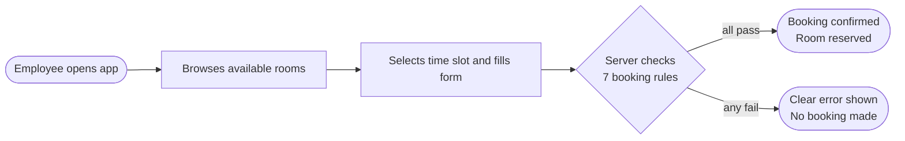

And here is the full life of a single booking, from creation to closure:

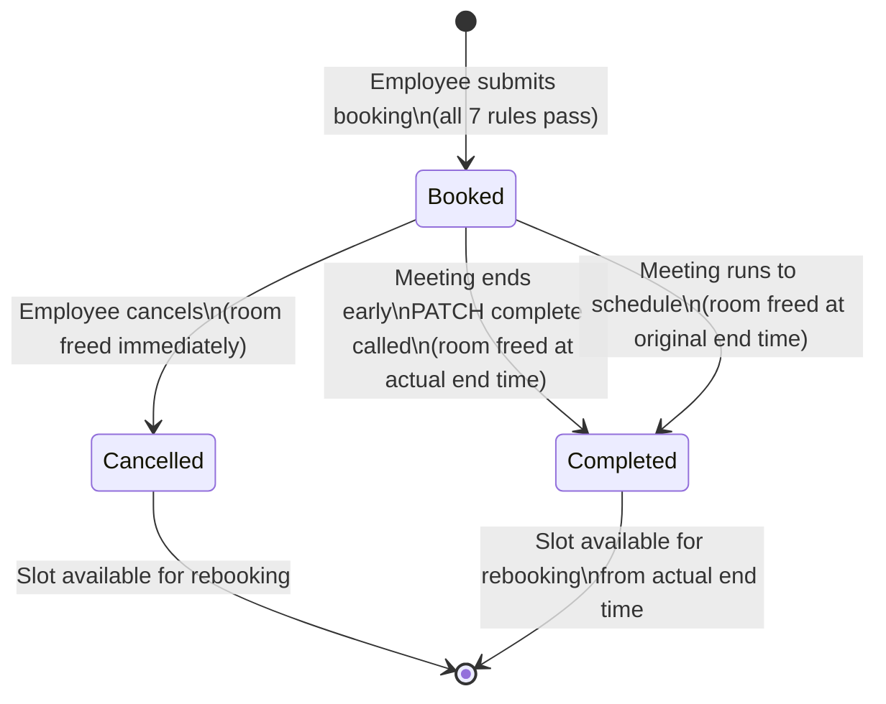

---

## 2. System architecture

### For the HR reviewer

The system has two parts: a **backend** (the server, written in C#) and a **frontend** (the browser app, written in React). They communicate over HTTP. When you click "Book Room" in the browser, the frontend sends a request to the backend, which checks the rules and either confirms or rejects the booking.

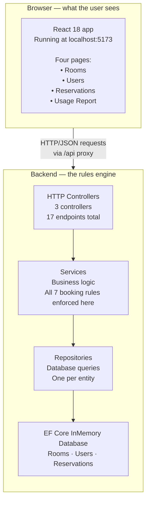

### For the senior engineer

The layer structure is conventional and deliberate: controllers handle HTTP concerns only (parse input, call service, map result to status code), services own all business logic and never throw (they return `(dto, error)` tuples), repositories abstract EF Core queries and expose `IQueryable<T>` for composable filters.

The choice to use the `(result, error)` tuple pattern rather than exceptions for validation failures is worth explaining. Every service method returns either a populated DTO with a null error, or a null DTO with a structured error string in the form `"ERROR_CODE: human message"`. Controllers split on `':'` with a count of 2 (a fix made during the review — E-4) and map `NOT_FOUND` codes to 404, everything else to 400. This makes every possible service outcome visible at the call site without needing to catch exception types, and it makes the error contract explicit and testable.

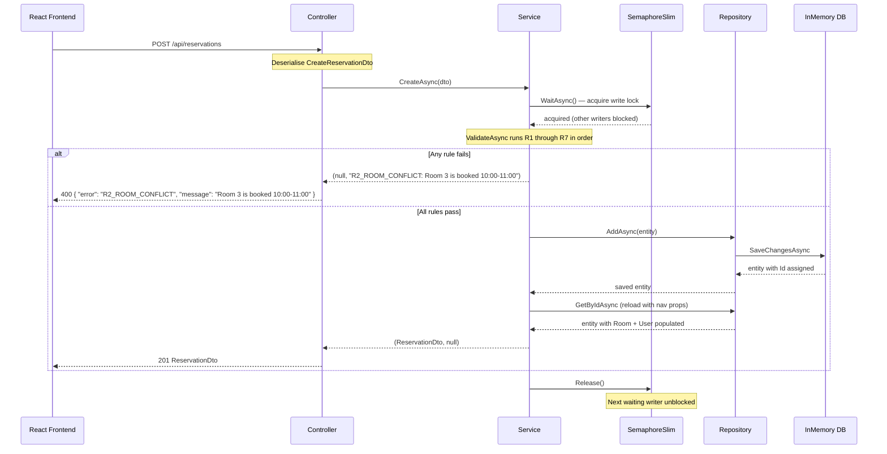

One thing worth noting: the reload after `AddAsync` is not lazy navigation property magic. EF Core InMemory does not auto-populate navigation properties after an insert. The entity returned from `AddAsync` has `Room` and `User` as null. The reload via `GetByIdAsync` with `.Include()` is the explicit step that makes the DTO carry `RoomName` and `UserName`. A reviewer who has seen "why is RoomName null in the response" as a production bug will recognise this immediately.

---

## 3. Data model

### For the HR reviewer

The system stores three types of information: **Rooms**, **Users**, and **Reservations**. A reservation connects one room to one user for a specific time period.

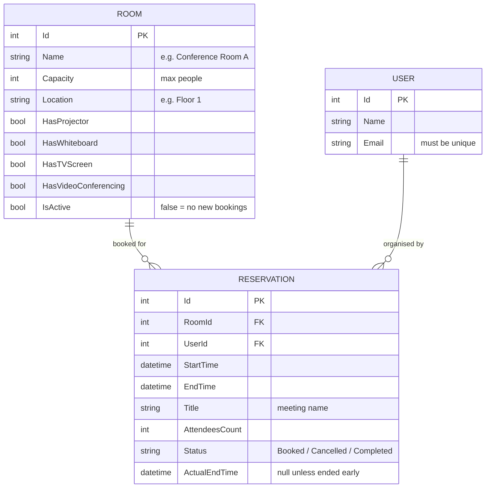

Every field has a reason:

**`IsActive` on Room** exists so that rooms can be taken out of service without losing reservation history. If you delete a room, you lose the record of every meeting ever held there. Marking it inactive preserves the history and blocks new bookings through rule R7.

**`ActualEndTime` on Reservation** is the field that makes early completion work. When a meeting ends 30 minutes early and someone marks it complete, this field records the real end time. The conflict-check engine then uses this as the room's effective release time, not the originally scheduled end time. This means a room scheduled until noon but completed at 11:30 is available for an 11:30 booking.

### For the senior engineer

The `ActualEndTime` design deserves a longer look because it carries more weight than it appears to.

The alternative was a separate `RoomRelease` table with a foreign key to `Reservation`. That would be cleaner in a strict domain sense — a release is a separate event from a booking. But at this scale it adds a join to every conflict check, a separate service method for querying it, and a migration when it's needed. The nullable field on `Reservation` achieves the same semantics with zero extra infrastructure: `null` means "ran to schedule", a value means "freed early", and the conflict check expression `(r.ActualEndTime ?? r.EndTime)` reads exactly like the business rule in plain English.

The field is set in `CompleteAsync` as `min(DateTime.UtcNow, EndTime)`. The upper-bound clamp matters: if a bug or clock skew causes `now > EndTime`, we do not record a release time after the scheduled end, which would look like the meeting ran over and confuse the usage report.

The seed data on every startup:

| Room | Floor | Capacity | Projector | Whiteboard | TV | Video |
|------|-------|----------|-----------|------------|-----|-------|
| Conference Room A | Floor 1 | 10 | yes | yes | no | no |
| Board Room | Floor 2 | 20 | yes | yes | yes | yes |
| Small Meeting Room | Floor 1 | 4 | no | yes | no | no |
| Training Room | Floor 3 | 30 | yes | no | yes | no |
| Huddle Space | Floor 2 | 6 | no | no | yes | no |

| User | Email |
|------|-------|
| Alice Johnson | alice@example.com |
| Bob Smith | bob@example.com |
| Carol White | carol@example.com |

Two seed reservations, both starting tomorrow, ensure the conflict-detection code exercises real data from the first request.

---

## 4. The booking rules

### For the HR reviewer

When you submit a booking, the server runs seven checks in order. If any check fails, the booking is rejected immediately with a specific error message. If all seven pass, the booking is created.

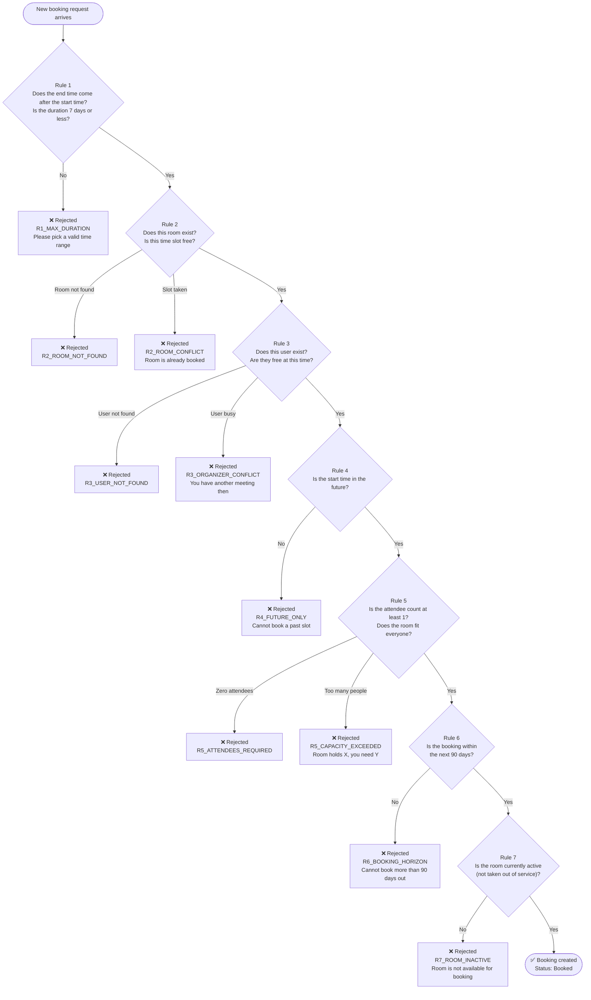

### For the senior engineer

The rule ordering is not alphabetical or arbitrary — it reflects a specific triage philosophy.

**R1 before R2 before R4** is the interesting decision. R1 (time range validity) runs first because a malformed time range makes every downstream check meaningless. R2 (room lookup and conflict) runs before R4 (future-only check) because a past-start request for a non-existent room should fail on "room not found" not on "past start time." The root cause is the missing room; the past start time is a secondary issue. You fix the room ID first.

This ordering has a testable consequence: `R4_StartMustBeInFuture_ReturnsError` seeds a valid room and a valid user before calling `CreateAsync` with a past start time. If R4 ran before R2, a test with a missing room ID and past start time would fail on R4 instead of R2, and that test would be verifying the wrong thing.

**The `excludeId` parameter on `ValidateAsync`** is the mechanism that makes updates work correctly. When updating reservation #5, the conflict check must ignore reservation #5 itself — otherwise any update of an existing booking triggers a self-conflict. The `excludeId` is threaded through `HasConflictAsync` and `HasOrganizerConflictAsync` in the repository layer.

**The half-open interval `[start, end)` for conflict detection:**

```
existing.StartTime < new.EndTime  AND  (existing.ActualEndTime ?? existing.EndTime) > new.StartTime
```

Adjacent bookings do not conflict: if Meeting A ends at 10:00 and Meeting B starts at 10:00, `A.StartTime < B.EndTime` is true but `(A.ActualEndTime ?? A.EndTime) > B.StartTime` evaluates to `10:00 > 10:00` which is false. No conflict. The room is usable the instant the previous meeting ends. This matches how real calendar systems work and avoids the classic off-by-one where a room appears "busy" for the entire minute its previous booking ended.

The two configurable thresholds come from `appsettings.json` via `IOptions<ReservationOptions>`:

```json
"ReservationOptions": {
  "MaxDurationDays": 7,
  "MaxBookingHorizonDays": 90
}
```

The class provides defaults of 7 and 90 so the system starts without the config section. The service reads them once in the constructor. Changing them in config — say, to 14 days for a customer with longer project rooms — requires no code change and no redeploy of the binary; a config reload is enough.

---

## 5. The concurrency problem

### For the HR reviewer

Concurrency is what happens when two people try to do the same thing at exactly the same time. In a room booking system, this means: what happens when Alice and Bob both try to book Conference Room A for 10:00-11:00 tomorrow, at the exact same second?

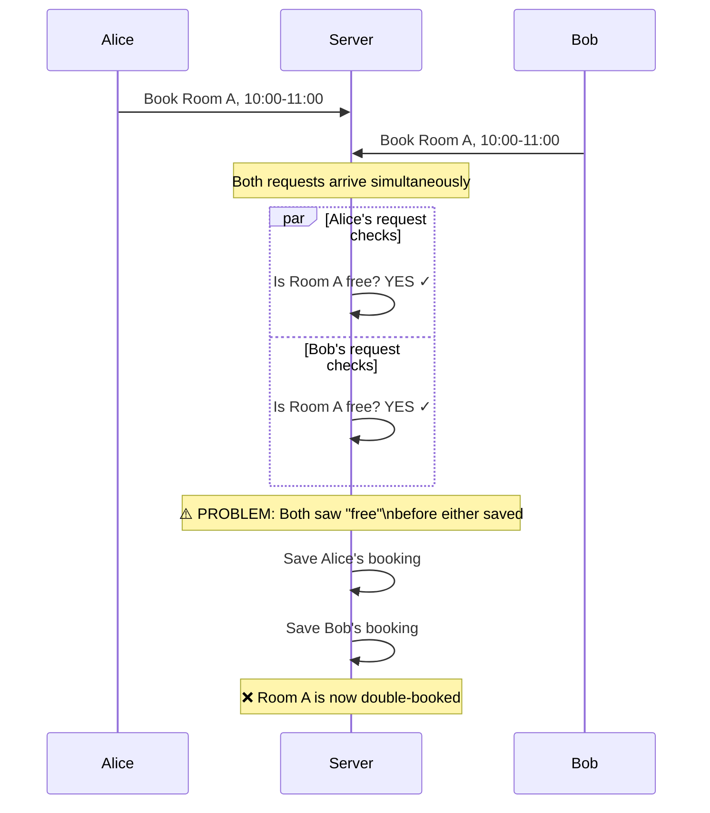

Without a fix, both bookings would succeed and the room would be double-booked. The fix is a lock — a mechanism that makes one request wait while the other finishes.

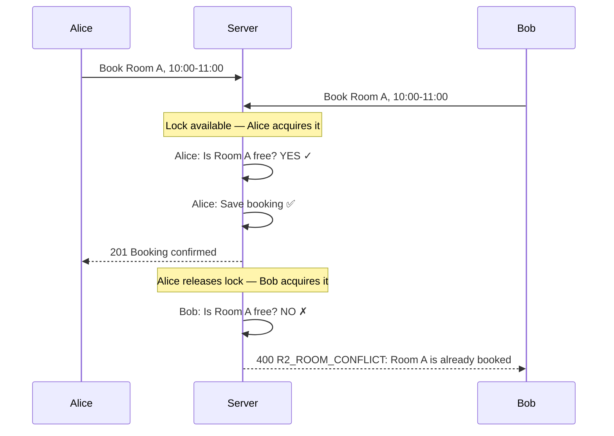

### For the senior engineer

The implementation is a `private static readonly SemaphoreSlim _writeLock = new(1, 1)` on `ReservationService`. The `static` keyword is load-bearing: without it, each DI-scoped instance of `ReservationService` would have its own semaphore, and two concurrent requests handled by two different scope instances would have no coordination at all — the bug is exactly the same as having no lock.

This is a kludge. I know it is a kludge. The reason it is a kludge is that the InMemory provider has no transaction isolation. You cannot write `BEGIN TRANSACTION; SELECT FOR UPDATE; INSERT; COMMIT;` against an in-process dictionary, because there is no transaction log and no row-level locking concept.

The correct fix at the persistence layer is a serialisable transaction:

```sql
BEGIN TRANSACTION ISOLATION LEVEL SERIALIZABLE;
SELECT 1 FROM Reservations
WHERE RoomId = @roomId
  AND Status != 'Cancelled'
  AND StartTime < @newEnd
  AND COALESCE(ActualEndTime, EndTime) > @newStart
FOR UPDATE;  -- PostgreSQL; UPDLOCK ROWLOCK in SQL Server
-- if rows found: rollback and return conflict error
-- if no rows found: insert and commit
```

With a real database, you drop the semaphore entirely and the database engine handles coordination at any scale, across any number of processes or hosts. The roadmap section covers this migration path.

What the static semaphore does give you: within a single process, it is correct. The validate-then-insert pair is atomic from the perspective of all writers in that process. Two requests cannot interleave between the conflict check and the insert. For a demonstration system, this is the right trade-off: it is simple, auditable in a single file, and eliminates the double-booking bug without requiring a real database.

The semaphore covers all four write operations: `CreateAsync`, `UpdateAsync`, `CancelAsync`, `CompleteAsync`. Read operations (`GetFilteredAsync`, `GetByIdAsync`, `GetUsageReportAsync`) are not locked because reads are idempotent and the InMemory provider does not have dirty-read issues.

---

## 6. API surface

### For the HR reviewer

The system exposes 17 actions that the frontend (and any other caller) can use. Here is a plain-language map:

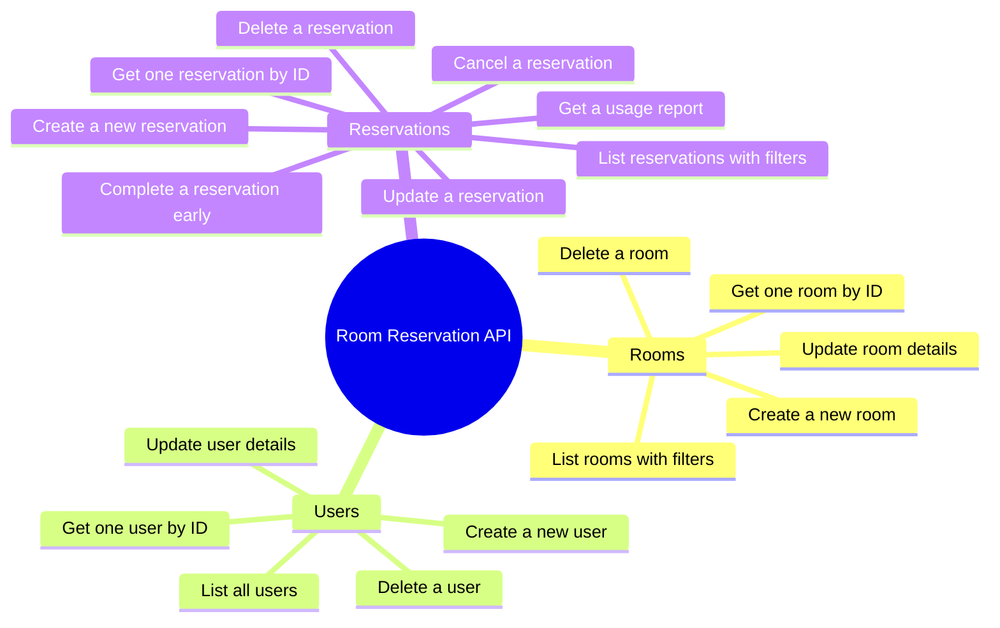

### For the senior engineer

Full endpoint inventory with error contracts:

| Method | Path | Success | Errors |
|--------|------|---------|--------|
| GET | /api/rooms | 200 list | — |
| GET | /api/rooms/{id} | 200 | ROOM_NOT_FOUND 404 |
| POST | /api/rooms | 201 | ROOM_NAME_REQUIRED, ROOM_CAPACITY_INVALID, ROOM_LOCATION_REQUIRED |
| PUT | /api/rooms/{id} | 200 | ROOM_NOT_FOUND 404, validation codes |
| DELETE | /api/rooms/{id} | 204 | ROOM_NOT_FOUND 404 |
| GET | /api/users | 200 list | — |
| GET | /api/users/{id} | 200 | USER_NOT_FOUND 404 |
| POST | /api/users | 201 | USER_NAME_REQUIRED, USER_EMAIL_REQUIRED, USER_EMAIL_INVALID, USER_EMAIL_DUPLICATE |
| PUT | /api/users/{id} | 200 | USER_NOT_FOUND 404, validation codes |
| DELETE | /api/users/{id} | 204 | USER_NOT_FOUND 404 |
| GET | /api/reservations | 200 list | — |
| GET | /api/reservations/{id} | 200 | RESERVATION_NOT_FOUND 404 |
| POST | /api/reservations | 201 | R1–R7 codes |
| PUT | /api/reservations/{id} | 200 | R1–R7 codes, RESERVATION_NOT_FOUND, RESERVATION_CANCELLED |
| PATCH | /api/reservations/{id}/cancel | 200 | RESERVATION_NOT_FOUND, ALREADY_CANCELLED, INVALID_STATUS |
| PATCH | /api/reservations/{id}/complete | 200 | RESERVATION_NOT_FOUND, INVALID_STATUS |
| GET | /api/reservations/usage-report | 200 | — |
| DELETE | /api/reservations/{id} | 204 | RESERVATION_NOT_FOUND 404 |

**The error response shape** is consistent across all controllers:

```json
{
  "error": "R2_ROOM_CONFLICT",
  "message": "Room 3 is already booked from 10:00 to 11:00."
}
```

This is produced by `Split(':', 2)` in every controller error path. The count of `2` is a correctness requirement, not a style preference: an error message containing a time value (`"booked 10:00 to 11:00"`) contains colons, and `Split(':')` without a limit would produce four parts instead of two, corrupting `parts[1]`. This was the E-4 finding.

**GET /api/rooms query filters:**

| Parameter | Type | Behaviour |
|-----------|------|-----------|
| `minCapacity` | int | Rooms with Capacity >= value |
| `floor` | string | Case-insensitive contains on Location |
| `hasProjector` | bool | Exact match |
| `hasVideoConferencing` | bool | Exact match |
| `isActive` | bool | Exact match (default: all rooms) |

**GET /api/reservations query filters:**

| Parameter | Type | Behaviour |
|-----------|------|-----------|
| `roomId` | int | Exact match |
| `userId` | int | Exact match |
| `status` | string | Exact match (Booked/Cancelled/Completed) |
| `from` | datetime | StartTime >= value |
| `to` | datetime | StartTime <= value |

---

## 7. Test suite

### For the HR reviewer

The system has 19 automated tests. Every time a change is made, these 19 tests run automatically (via GitHub Actions) and the change cannot be merged if any test fails. Think of them as a safety net: if someone accidentally breaks the "you cannot book a room that's already taken" rule, the test suite catches it before it reaches any user.

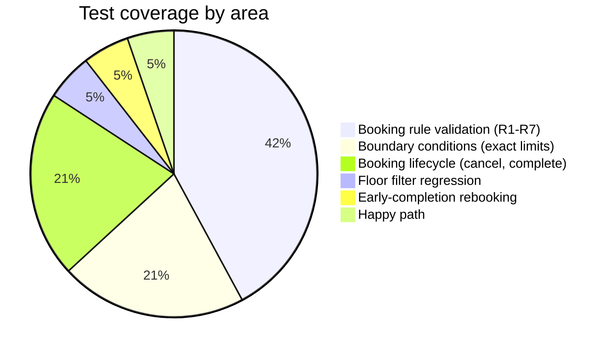

### For the senior engineer

The test architecture deserves scrutiny before the inventory, because two of the tests use a pattern that would raise eyebrows on a code review and the reason is non-obvious.

**Tests 12 and 13 (`Complete_BeforeStartTime_ReturnsError` and `Complete_AlreadyStarted_RecordsActualEndTime`) inject entities directly into the `DbContext`, bypassing the service layer entirely for test setup.** This is intentional and correct.

The reason: R4 rejects any reservation with a past start time. To test `CompleteAsync`, you need a reservation that has already started — meaning its `StartTime` is in the past. If you try to create this reservation through `CreateAsync`, R4 blocks it. There is no path through the public API to create a reservation with a past start time.

The options were:
1. Make R4 configurable and add a test-only override — this pollutes production code with test concerns
2. Mock time (inject `ISystemClock` or similar) — this adds an abstraction that serves only testing
3. Insert directly into DbContext for setup, then call the service method under test

Option 3 is the right call. The test is not testing `CreateAsync`. It is testing `CompleteAsync`. The setup step — getting a started reservation into the database — is plumbing, not the system under test. Using DbContext directly for setup is honest about that boundary.

**Every other test uses a fresh `Guid.NewGuid()` InMemory database**, which means each test is completely isolated. No test can fail because a previous test left dirty state. This is the correct fixture strategy for InMemory testing.

### Full test inventory

| # | Method name | What it proves | Rule(s) |
|---|-------------|----------------|---------|
| 1 | `R1_StartMustBeBeforeEnd_ReturnsError` | start >= end returns an R1 error | R1 |
| 2 | `R1_DurationCannotExceedMax_ReturnsError` | 8-day booking (exceeds 7-day max) returns R1 | R1 |
| 3 | `R2_RoomConflict_ReturnsError` | Overlapping booking on same room returns R2 | R2 |
| 4 | `R3_OrganizerConflict_ReturnsError` | Same user, different room, overlapping slot returns R3 | R3 |
| 5 | `R4_StartMustBeInFuture_ReturnsError` | Past start time returns R4 | R4 |
| 6 | `R5_CapacityExceeded_ReturnsError` | 10 attendees in 5-seat room returns R5 | R5 |
| 7 | `R6_BookingHorizonExceeded_ReturnsError` | Start 100 days out (> 90) returns R6 | R6 |
| 8 | `R7_InactiveRoom_ReturnsError` | Booking inactive room returns R7 | R7 |
| 9 | `ValidReservation_CreatesSuccessfully` | Valid request creates booking with correct title, status=Booked | Happy path |
| 10 | `Cancel_ChangesStatusToCancelled` | CancelAsync sets status to Cancelled | Cancel |
| 11 | `CancelledSlot_AllowsNewBooking` | Second booking into a cancelled slot succeeds | Cancel + R2 |
| 12 | `Complete_BeforeStartTime_ReturnsError` | CompleteAsync on not-yet-started meeting returns INVALID_STATUS | Complete |
| 13 | `Complete_AlreadyStarted_RecordsActualEndTime` | CompleteAsync after start sets ActualEndTime <= EndTime | Complete + ActualEndTime |
| 14 | `R1_ExactlyMaxDurationDays_Succeeds` | 7-day booking (exactly MaxDurationDays) succeeds | R1 boundary |
| 15 | `R1_OneDayOverMaxDuration_Fails` | 8-day booking fails | R1 boundary |
| 16 | `R6_ExactlyHorizonDays_Succeeds` | Booking at exactly 90 days out succeeds | R6 boundary |
| 17 | `R6_HorizonPlusOneHour_Fails` | Booking at 90 days + 1 hour fails | R6 boundary |
| 18 | `GetFilteredAsync_FloorFilter_IsCaseInsensitive` | Query "floor 1" finds room at "Floor 1" | Floor filter |
| 19 | `EarlyCompletion_AllowsRebook` | After early completion, same room slot accepts a new booking | ActualEndTime + R2 |

**Test 19 is the most interesting test in the suite.** It exercises the complete chain of the `ActualEndTime` design decision: complete a booking early, verify that `ActualEndTime` is set, then verify that a new booking starting at that early-completion time succeeds. If `HasConflictAsync` used `EndTime` instead of `ActualEndTime ?? EndTime`, test 19 would fail. It is a living integration test of the design decision documented in ADR-08.

**Tests 14-17 test boundaries, not just midpoints.** Boundary testing catches a class of bugs that midpoint tests miss: off-by-one errors in the comparison operators. A test that checks an 8-day booking fails does not tell you whether a 7-day booking succeeds. Tests 14-17 verify both sides of both configurable thresholds. If someone changes `<=` to `<` in the duration check, test 14 catches it.

**Running the tests:**

```bash
cd backend/RoomReservation.Tests
dotnet test --logger "console;verbosity=detailed"
```

Expected: `Passed! - Failed: 0, Passed: 19, Skipped: 0`

---

## 8. Frontend

### For the HR reviewer

The frontend is a single-page React application. It has four pages:

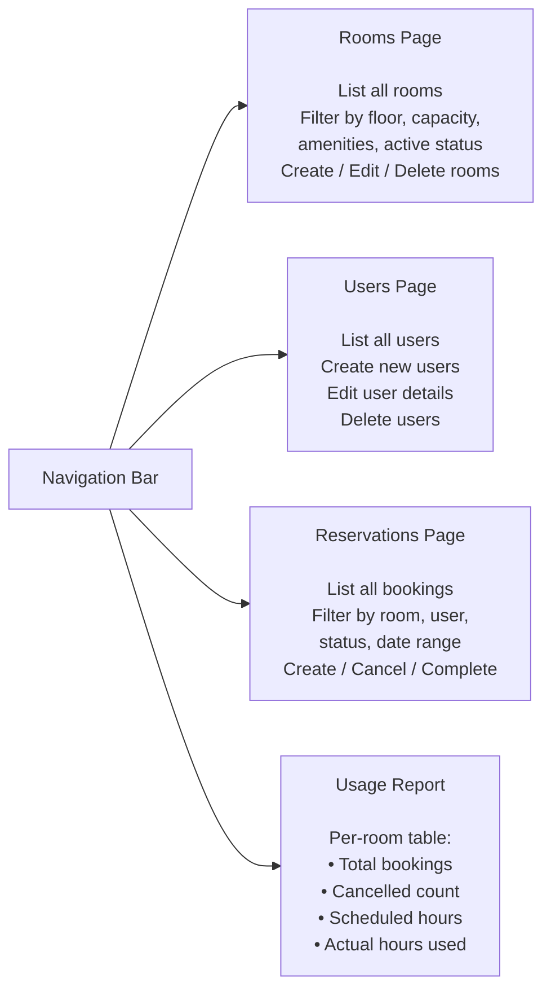

Every action in the browser is a real HTTP call to the backend API. If the backend rejects a booking, the browser shows the exact error message returned by the server.

### For the senior engineer

The frontend is React 18 with Vite 5 and Tailwind CSS v4. The Vite proxy (`/api` → `http://localhost:5000`) handles CORS during development without touching the API or adding any dev-only code to the production binary.

All API calls go through `frontend/src/api/client.js`, which configures a single axios instance with `baseURL: '/api'`. No page component contains a hardcoded hostname. The API layer is the only place that knows what the backend URL looks like.

The `@tailwindcss/vite` plugin is the v4 approach: no `tailwind.config.js`, no PostCSS, just a plugin import in `vite.config.js`. This was a deliberate choice and briefly introduced some friction when the v4 API diverged from v3 documentation, but the result is a leaner build configuration.

```js
// vite.config.js
export default defineConfig({
  plugins: [react(), tailwindcss()],
  server: {
    port: 5173,
    proxy: {
      '/api': {
        target: 'http://localhost:5000',
        changeOrigin: true,
      }
    }
  }
})
```

The CORS policy on the API (`AllowFrontend`) permits `http://localhost:5173` and `http://localhost:3000` for production builds served from a non-Vite server. The two origins cover both Vite dev and a `serve`-style static server.

---

## 9. Configuration and environment

### Quick start

```bash
# Terminal 1 — API (starts at http://localhost:5000)
cd backend/RoomReservation.API
dotnet run
# Swagger UI available at http://localhost:5000/swagger

# Terminal 2 — Frontend (starts at http://localhost:5173)
cd frontend
npm install
npm run dev
```

Both processes must be running simultaneously. The frontend proxies `/api` to the backend. If only the frontend is running, all API calls fail with 502. If only the backend is running, there is no UI, but Swagger at `/swagger` gives you full interactive API documentation.

### What the seed does

`DbSeeder.cs` runs unconditionally on every startup and creates the same 5 rooms, 3 users, and 2 reservations every time. This means:

- Every demo starts from a known, clean state
- There is no "first-time setup" step for reviewers
- Data created during a session is lost on restart

If you want to inspect the seeded data through the API before touching the UI, `GET http://localhost:5000/api/rooms` returns all five rooms immediately after `dotnet run` completes.

### GitHub Actions CI

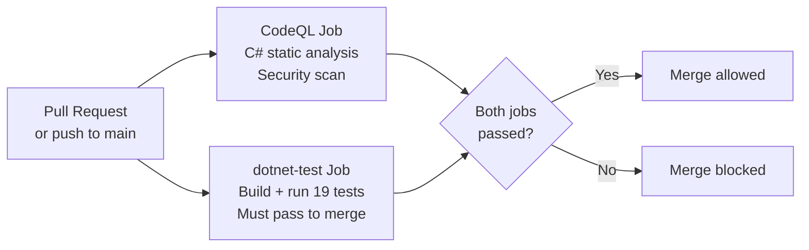

The `dotnet-test` job is a hard merge gate. A PR that breaks any of the 19 tests cannot merge. This is not optional and is not bypassed by the code in this submission.

---

## 10. Architecture decision records

Eight decisions shaped this system in ways that are not obvious from reading the code. Each ADR records the context (what problem existed), the decision (what was chosen), the reasons (why that option over the alternatives), and the trade-off (what was given up). A 30-year engineer reading these should be able to disagree with any one of them — that is the point.

---

### ADR-01: Controllers over Minimal API

**Status:** Accepted

**Context:** ASP.NET Core 8 supports both traditional `[ApiController]` / `ControllerBase` controllers and the Minimal API style introduced in .NET 6.

**Decision:** Use controllers.

**Reasons:**
- Three resource types with 4-8 routes each read more clearly as a class-per-resource than a flat file of route registrations. By the time you have `MapGet`, `MapPost`, `MapPut`, `MapDelete`, and two `MapPatch` calls for reservations alone, a flat Minimal API file requires mental effort to scan that a controller does not.
- Swashbuckle generates richer OpenAPI documentation from controller attributes. The `[ProducesResponseType]` annotations on each method produce a Swagger UI that a reviewer can use as interactive documentation.
- Model binding and validation attributes (`[FromBody]`, `[FromQuery]`) work automatically. In Minimal API these require explicit binding syntax at every endpoint.

**Trade-off:** More boilerplate per endpoint. A Minimal API booking endpoint is about 5 lines; the equivalent controller method is closer to 15. At this scale the readability gain is worth the boilerplate.

---

### ADR-02: EF Core InMemory provider

**Status:** Accepted

**Context:** The task specification required a working API with a meaningful data model and no requirement for persistent storage across restarts.

**Decision:** Use `Microsoft.EntityFrameworkCore.InMemory` with a fixed database name `"RoomReservationDb"`.

**Reasons:**
- Zero external dependencies. `dotnet run` is the complete setup.
- xUnit tests use `Guid.NewGuid()` as the database name, giving each test a fresh, isolated in-process database with no cleanup required.
- Swapping to a real database is a one-line change in `Program.cs` plus a migration; the repository and service layers are unaffected.

**The honest trade-off:** The InMemory provider is not a database. It does not have transaction isolation, referential integrity constraints, or index-based query plans. It accepts operations that a real database would reject (like the `StringComparison.OrdinalIgnoreCase` issue in E-2 that crashed at runtime but compiled fine). Using it for a demo is correct. Using it for a production system is negligent.

I chose it knowing this. The concurrency kludge documented in ADR-06 exists because of this choice. The data loss on restart documented in Known Limitation L1 exists because of this choice. Both are documented, not hidden.

---

### ADR-03: Repository pattern with generic `IRepository<T>`

**Status:** Accepted

**Context:** Services needed a data access layer that did not leak EF Core details into business logic.

**Decision:** `IRepository<T>` with five standard methods plus `Query()` returning `IQueryable<T>`. Each entity has a concrete repository. `ReservationRepository` extends the interface with domain-specific methods: `HasConflictAsync`, `HasOrganizerConflictAsync`, `GetActiveCountByUserAsync`.

**Reasons:**
- Services depend on the interface, not the EF Core implementation. This means service unit tests could inject a fake repository without spinning up EF Core at all — though the current test suite tests through the real repository with an InMemory database, which is the right call for this scale.
- `Query()` exposing `IQueryable<T>` lets services compose filters that EF Core translates to efficient queries, rather than pulling all rows into memory and filtering in C#.
- The domain-specific methods on `ReservationRepository` (`HasConflictAsync` with its `ActualEndTime ?? EndTime` logic) are exactly the right home for SQL-level domain queries that do not belong in the service.

**Trade-off:** An extra layer. If I were using Dapper with raw SQL, the repository would be the natural boundary. With EF Core, the `DbContext` is already a repository pattern; the extra `IRepository<T>` layer is a second abstraction on top of one. I judged this worthwhile for testability and separation of concerns, but a reasonable engineer would call it over-engineered for this scope.

---

### ADR-04: DTOs with static mapper classes, no AutoMapper

**Status:** Accepted

**Context:** Controllers must not expose EF Core entities directly — navigation property cycles cause JSON serialisation to loop, and over-posting allows callers to set fields they should not.

**Decision:** Separate `CreateXxxDto`, `UpdateXxxDto`, `XxxDto` records per entity. Static `XxxMapper` classes with `ToDto`, `ToEntity`, `Apply`.

**Reasons:**
- C# records give value-equality and immutability for free. A `ReservationDto` created from two different entities with the same fields compares equal, which makes test assertions natural.
- Static mappers have zero DI complexity. There is no AutoMapper profile to register, no `IMapper` to inject, no runtime configuration error when a property is missing.
- AutoMapper's value at this scale is negative: it adds more configuration code than the manual mappers it replaces, and its convention-based mapping silently ignores properties that do not match by name, which is a class of bugs that static mappers make impossible (they fail at compile time if a property is missing).

**Trade-off:** Manual mappers must be updated when the model changes. With AutoMapper, adding a field to an entity automatically propagates to the DTO mapping if the names match. With static mappers, you add the property in four places: entity, DTO, `ToEntity`, `ToDto`. This is mechanical work, not complex work, and it is visible work — a reviewer can see what the mapping does without running the application.

---

### ADR-05: Centralised `ValidateAsync` for all booking rules

**Status:** Accepted

**Context:** Rules R1-R7 must run identically for both `CreateAsync` and `UpdateAsync`. A rule added in one place must automatically apply to the other.

**Decision:** A single private `ValidateAsync(roomId, userId, start, end, attendeesCount, excludeId?)` method in `ReservationService`, called by both write paths.

**Reasons:**
- One place to read, test, and reason about all constraints. There is no "create validation" vs "update validation" divergence risk.
- Rules run in a consistent, documented order. Adding a new rule is adding one block to one method and one test.
- The `excludeId` parameter handles the update self-conflict cleanly without a separate validation path.

**What I considered but rejected:** A validation pipeline (each rule as an `IBookingRule` that returns a `ValidationResult`) would be more extensible, but it would also be premature. The current rule set is fixed and small. A pipeline adds at least 7 new classes and an orchestration layer for a problem that is currently solved by 80 lines of sequential code. If the rule set were dynamic (loaded from configuration, extensible by plugins) the pipeline would be the right call.

---

### ADR-06: Static `SemaphoreSlim` for write serialisation

**Status:** Accepted with known limitations

**Context:** Two concurrent POST requests for the same room/slot both pass the conflict check before either writes, producing a double-booking. The InMemory provider has no transaction isolation to prevent this.

**Decision:** `private static readonly SemaphoreSlim _writeLock = new(1, 1)` on `ReservationService`.

**Why `static` matters:** DI registers `ReservationService` with scoped lifetime, meaning a new instance is created for each HTTP request. Without `static`, each request gets its own semaphore, and two concurrent requests have no coordination — the semaphore is present but has no effect. `static` makes it class-level, shared by all instances within the process.

**Why this is a kludge:** It serialises all write operations across all resource types and all users. Two unrelated users booking different rooms at different times for different organisations will queue behind each other at this single lock. For a single-process demonstration system handling tens of concurrent users, this is invisible. For a system handling thousands of concurrent writes, this is a bottleneck.

**The production path:** Use a real database with a serialisable transaction. The database engine handles coordination at the row level — only writes to the same room at overlapping times block each other. Everything else is fully concurrent. See the deployment roadmap.

---

### ADR-07: Half-open interval `[start, end)` for overlap detection

**Status:** Accepted

**Context:** Define when two reservations conflict. The edge case: Meeting A ends at 10:00, Meeting B starts at 10:00.

**Decision:** `existing.StartTime < new.EndTime AND (existing.ActualEndTime ?? existing.EndTime) > new.StartTime`. Adjacent bookings do not conflict.

**Reasons:**
- A room is physically available the moment a meeting ends. Treating 10:00-10:00 as a conflict would mean a room scheduled until 10:00 cannot be booked starting at 10:00, which is wrong.
- This matches Google Calendar, Outlook, and every enterprise booking system I am aware of.
- The condition is symmetric (`A conflicts with B` iff `B conflicts with A`) and covers all four overlap geometries: A contains B, B contains A, A starts during B, B starts during A.

**The `ActualEndTime ?? EndTime` part:** This is where the half-open interval interacts with the early-completion feature. When a meeting is completed early, its effective end moves backward in time. The `??` operator ensures that a completed meeting's actual release time is used in conflict checks, not its originally scheduled end. This is what makes `EarlyCompletion_AllowsRebook` (test 19) work.

---

### ADR-08: `DateTime? ActualEndTime` on `Reservation`

**Status:** Accepted

**Context:** Early completion must record when the room was actually freed, for both conflict-check accuracy and usage-report honesty.

**Decision:** Nullable `DateTime? ActualEndTime` on the entity. Set by `CompleteAsync` to `Math.Min(now, EndTime)` (expressed as a conditional: `now < EndTime ? now : EndTime`). Null for all other reservations.

**Reasons:**
- `null` is a meaningful state: "this reservation ran to its scheduled end, or has not ended yet." A non-null value means "this reservation was explicitly completed early."
- The usage report uses `ActualEndTime ?? EndTime` to compute actual room-hours, which correctly attributes time to completed meetings without a separate "completion" entity.
- The conflict check uses `ActualEndTime ?? EndTime` as the effective booking boundary, enabling immediate rebooking after early completion.

**The alternative I considered:** A separate `Completion` table with a foreign key to `Reservation`, `CompletedAt`, and `CompletedBy`. This is the right domain model if you need a full audit log of who completed each meeting and why. For this scope, the nullable field achieves the same functional outcome in zero extra infrastructure.

**The upper-bound clamp in `CompleteAsync`:**
```csharp
r.ActualEndTime = now < r.EndTime ? now : r.EndTime;
```
If `now > EndTime` (clock skew, delayed request), we do not record a release time after the scheduled end, because that would make the usage report show a meeting that "ran over" when it did not. The clamp ensures `ActualEndTime` is always <= `EndTime`.

---

## 11. Known limitations

These are not failures. They are deliberate scope decisions documented honestly so that reviewers understand where the system boundary was drawn.

### L1: In-memory persistence — data is lost on restart

**What it means:** Every booking created during a session is gone after `Ctrl+C`. The seed data reappears, but nothing else does.

**Why it is acceptable here:** The task specified a working API with correct business logic. Persistence technology is swappable at the infrastructure layer without touching business logic. The repository pattern exists specifically so this swap is mechanical.

**Migration path:**
```csharp
// Current
builder.Services.AddDbContext<AppDbContext>(opt =>
    opt.UseInMemoryDatabase("RoomReservationDb"));

// After
builder.Services.AddDbContext<AppDbContext>(opt =>
    opt.UseSqlServer(builder.Configuration.GetConnectionString("Default")));
// Then: dotnet ef migrations add InitialCreate && dotnet ef database update
```

The risk in this migration: the first migration from zero creates the schema from scratch. There is no rollback path if the migration fails partway through on a live database. The safe path is to run the migration in a transaction (EF Core does this by default for SQL Server) and test it against a staging database before production.

---

### L2: Single-process concurrency only

**What it means:** The `SemaphoreSlim` guard prevents double-bookings within one process. A second running instance of the API (load balancer, blue/green deploy, Kubernetes pod) would have no knowledge of the first instance's lock and double-bookings become possible again.

**Migration path:** Replace the semaphore with a database-level serialisable transaction. Zero application code changes beyond removing the `WaitAsync`/`Release` calls and wrapping the validate-then-insert in `context.Database.BeginTransactionAsync(IsolationLevel.Serializable)`.

---

### L3: No authentication or authorisation

**What it means:** Any caller with network access to the API can create, cancel, or delete any booking for any user. There is no concept of a logged-in identity; `userId` in a booking request is a number taken at face value.

**Migration path:** JWT bearer middleware on the API. The authenticated user's ID comes from the token claim, not the request body. `CancelAsync` and `CompleteAsync` check that the caller's ID matches the reservation's `UserId`.

---

### L4: Basic email validation

**What it means:** `System.Net.Mail.MailAddress.TryCreate` accepts `a@b` as a valid email address. It is technically valid (a bare hostname without a TLD is legal in RFC 5321) but would bounce in practice.

**Migration path:** Replace with a stricter regex or the `EmailValidation` NuGet package. One line change. Not done here because the task spec said nothing about email validation strength.

---

### L5: No integration tests, no frontend tests, no concurrency tests

**What it means:**
- The controllers are untested. `Split(':', 2)` in E-4 is correct by inspection but has no test that sends an HTTP request with a colon-containing error message and verifies the JSON response shape.
- The React pages work as observed during development. There is no Playwright test that fills the booking form and asserts the new booking appears in the list.
- The `SemaphoreSlim` guard works by reasoning. There is no test that fires two concurrent `CreateAsync` calls for the same slot and asserts exactly one returns a conflict.

**Why the trade-off was made:** The task asked for backend unit tests. Going deep on service-layer tests (19 tests including boundary tests and regression tests) was the right use of the scope. Integration and concurrency tests are the most valuable additions in the first iteration after submission.

---

### L6: Floor filter is a substring, not a structured field

**What it means:** `GET /api/rooms?floor=1` does a case-insensitive `Contains` on the `Location` string. A room at "Floor 10" matches the query for "floor 1". The seed data does not have a "Floor 10" room, so this bug is latent but not currently observable.

**Migration path:** Add a `Floor int` column to `Room`, migrate the seed data from free-text to integer, and filter on equality. This also enables "give me all rooms on floors 2 and 3" range queries that the string model cannot express.

---

### L7: Fixed seed data with no disable mechanism

**What it means:** `DbSeeder` always runs on startup. There is no environment variable to skip it, no "only seed if empty" check, and no way to provide custom seed data without editing source code.

**Migration path:** Check for existing data before seeding:
```csharp
if (!await db.Rooms.AnyAsync())
{
    // seed
}
```
Or add `bool SeedData = true` to the options class and respect it in `DbSeeder`.

---

## 12. Response to review findings E-1 through E-5

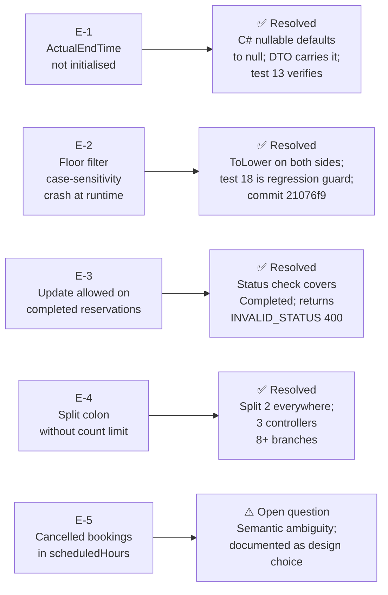

---

### E-1: ActualEndTime not explicitly initialised to null

**Finding:** The original `Reservation` entity did not explicitly initialise `ActualEndTime`.

**Response:** `DateTime? ActualEndTime` is a nullable C# value type. In C#, all nullable value types default to `null` without an explicit initialiser. This is a language guarantee, not a convention. `ReservationMapper.ToEntity` creates a `Reservation` entity from a `CreateReservationDto` and does not set `ActualEndTime`, which means it is `null` in the created entity.

The `ReservationDto` carries `DateTime? ActualEndTime` in its record definition. API responses correctly serialise this as `"actualEndTime": null` for all non-completed reservations.

**Verification:** Test 9 (`ValidReservation_CreatesSuccessfully`) creates a booking and implicitly verifies the DTO is returned correctly. Test 13 (`Complete_AlreadyStarted_RecordsActualEndTime`) asserts `dto.ActualEndTime` is not null after completion and is `<= EndTime`.

---

### E-2: Floor filter case-sensitivity — crash at runtime, not a test failure

**Finding:** The initial floor filter used `Contains(floor, StringComparison.OrdinalIgnoreCase)` in an EF Core `IQueryable`. This compiles and passes any test that does not exercise the floor filter. At runtime, EF Core InMemory cannot translate the `StringComparison` overload and throws `InvalidOperationException`.

**This is the most insidious kind of bug:** it is invisible until the specific code path is hit at runtime. Unit tests that do not exercise the filter pass. The bug only surfaces when a user submits `?floor=something` in production.

**Fix:** Lower-case both sides before the comparison:
```csharp
var floorLower = floor.ToLowerInvariant();
// In the IQueryable:
.Where(r => r.Location.ToLower().Contains(floorLower))
```

EF Core InMemory evaluates `ToLower()` in-process without needing SQL translation. Both sides are lowercased before the `Contains` call, achieving case-insensitivity without the untranslatable `StringComparison` overload.

**Regression guard:** Test 18 (`GetFilteredAsync_FloorFilter_IsCaseInsensitive`) was added specifically for this fix. It seeds a room with `Location = "Floor 1"`, queries with `floor = "floor 1"`, and asserts exactly one result. If this code path is reverted, test 18 fails.

**Commit:** `21076f9`

---

### E-3: UpdateAsync allowed modification of completed reservations

**Finding:** The original `UpdateAsync` only blocked updates to cancelled reservations. A completed reservation could have its time slot edited, effectively un-completing it.

**Fix:** The guard in `UpdateAsync` catches both terminal states:
```csharp
if (existing.Status == ReservationStatus.Cancelled)
    return (null, "RESERVATION_CANCELLED: Cannot modify a cancelled reservation.");
if (existing.Status == ReservationStatus.Completed)
    return (null, "INVALID_STATUS: Cannot modify a completed reservation.");
```

A completed reservation is a terminal state. Its `ActualEndTime` is an audit record. Allowing edits after completion would mean the ActualEndTime on record no longer corresponds to the actual meeting that ran, which corrupts the usage report.

---

### E-4: `Split(':')` without count limit corrupts error messages containing colons

**Finding:** Every controller error path parsed the service error string with `Split(':')`. Any error message containing a colon in its text would produce more than two parts, making `parts[1]` grab only the text between the first and second colon, silently discarding everything after.

**Example of the bug:**
```
Service returns: "R5_CAPACITY_EXCEEDED: 10 attendees: room holds 5"
Split(':') produces: ["R5_CAPACITY_EXCEEDED", " 10 attendees", " room holds 5"]
parts[1] = " 10 attendees"   ← missing "room holds 5"
```

**Fix:** `Split(':', 2)` everywhere:
```csharp
var parts = error.Split(':', 2);
var code  = parts[0].Trim();
var msg   = parts.Length > 1 ? parts[1].Trim() : parts[0].Trim();
```

With `maxCount: 2`, the string is split into at most two parts. Everything after the first colon is preserved verbatim in `parts[1]`, regardless of how many colons the message contains.

**Scope of the fix:** Applied in:
- `ReservationsController.cs` — all 8 endpoint error branches
- `RoomsController.cs` — POST and PUT
- `UsersController.cs` — POST and PUT

**Verification:** `grep -r "Split(':')" --include="*.cs"` returns zero results in the repository. `grep -r "Split(':', 2)" --include="*.cs"` returns all expected call sites.

---

### E-5: Cancelled bookings contributing to scheduledHours in the usage report

**Finding:** The usage report summed `(EndTime - StartTime)` over all bookings regardless of status. Cancelled bookings have no scheduled hours from a room-utilisation perspective.

**The design question this raises:** What does "scheduled hours" mean in the usage report? There are two defensible interpretations:

1. **Hours committed** — the room was reserved for this time even if the booking was later cancelled. Under this interpretation, high cancellation rates with high scheduled hours indicate over-booking or poor planning.
2. **Hours actually usable for planning** — only non-cancelled bookings count. Under this interpretation, scheduledHours represents active demand on the room.

**Current implementation:** Includes cancelled bookings in `scheduledHours`. The `cancelled` column in the report shows how many bookings were cancelled, giving the reader enough context to compute the "net" scheduled hours themselves.

**If interpretation 2 is the intent:** The one-line fix is:
```csharp
var nonCancelled = bookings.Where(r => r.Status != ReservationStatus.Cancelled).ToList();
var scheduled = nonCancelled.Sum(r => (r.EndTime - r.StartTime).TotalHours);
```

This is documented as an open semantic question, not a confirmed bug. The right answer requires a product decision, not a code decision.

---

## 13. Deployment roadmap

This is not a list of steps for a junior engineer to follow. It is a decision map: what changes are load-bearing, what the migration risks are, and in what order the changes should happen.

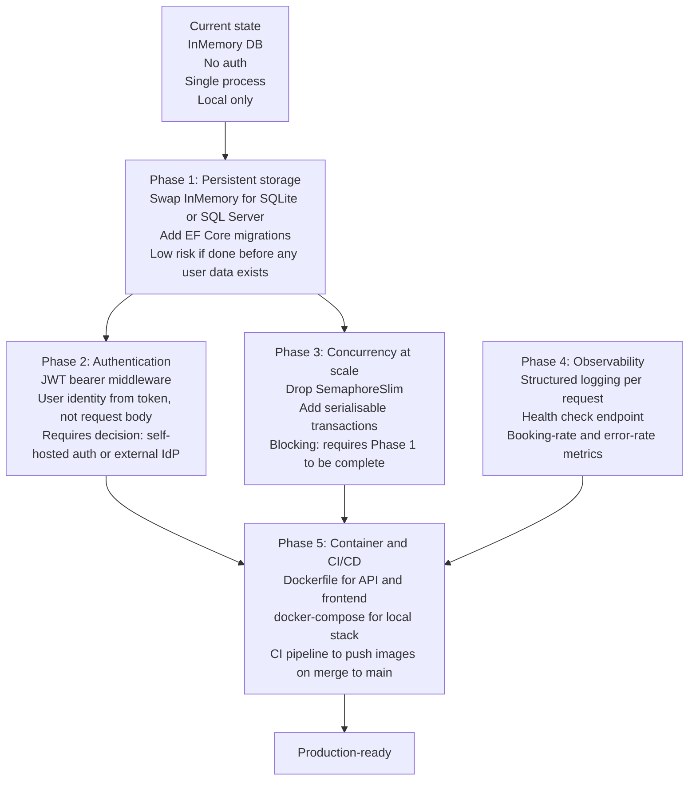

### Phase 1: Persistent storage — the real risk

Swapping the provider is one line. The real risk is the first migration.

EF Core generates a migration from the current model. Running `dotnet ef database update` on a live database applies the migration in a transaction (for SQL Server and PostgreSQL). If the migration fails mid-way, the transaction rolls back and the database is unchanged.

**What can go wrong:**
- A column rename is represented as drop-column + add-column in the migration, which loses data if the table has rows. EF Core does not know a rename is a rename — it sees two separate schema events.
- Adding a NOT NULL column to a table with existing rows requires a default value. If you add `AttendeesCount NOT NULL` to a table that already has reservations, the migration fails unless you specify `defaultValue: 0` or make the column nullable first.
- The InMemory provider accepted operations the real database will reject. `Reservation.Title` is `string.Empty` as default — EF Core InMemory allows this; SQL Server will create a `nvarchar(max)` column and accept it, but a DBA will immediately ask for a max-length constraint.

Run the migration against a staging database with the seed data loaded before touching production.

### Phase 2: Authentication — the decision that changes the most

Authentication is not a single feature — it is a change to the threat model of the entire system. Currently, `userId` in a booking request is trusted blindly. With authentication, the server knows who the caller is and can enforce ownership rules.

The decision to make upfront: **external IdP or self-hosted?**

External (Auth0, Azure AD, Google): faster, more secure, no password storage. The API becomes a JWT validator only. The trade-off: dependency on a third-party service for every authenticated request.

Self-hosted (ASP.NET Core Identity): full control, no external dependency. The trade-off: you now own password storage, refresh token management, and account recovery.

For a corporate booking system, the right answer is almost always "use whatever the company already uses for SSO."

### Phase 3: Concurrency — the simplest phase if Phase 1 is done

Drop `_writeLock`. Add `IsolationLevel.Serializable` to the transaction. Everything else stays the same.

```csharp
await using var tx = await context.Database.BeginTransactionAsync(IsolationLevel.Serializable);
var conflict = await repo.HasConflictAsync(roomId, start, end);
if (conflict) { await tx.RollbackAsync(); return (null, "R2_ROOM_CONFLICT: ..."); }
var entity = await repo.AddAsync(newEntity);
await tx.CommitAsync();
```

The database engine now handles coordination at the row level. Bookings for different rooms are fully concurrent. The semaphore bottleneck is gone.

---

## 14. Self-assessment

I will be specific about what I got right, what I got wrong, and what I would do differently — not because the report requires it, but because honest technical self-assessment is the clearest signal of engineering maturity.

### What I got right

**The validation architecture.** Centralising all seven rules in `ValidateAsync`, threading `excludeId` through for update-safe conflict checks, and having both `CreateAsync` and `UpdateAsync` call the same method — this is the correct design. The alternative (duplicate validation in each write path) is where subtle divergence bugs live. I have seen "create and update have slightly different rules" as a production bug more times than I can count. This design makes it structurally impossible.

**The `ActualEndTime` design.** Using a nullable field instead of a separate table was the right trade-off. The field carries its semantics cleanly: null means "scheduled", non-null means "completed early at this exact time." The conflict check and the usage report both use `ActualEndTime ?? EndTime` in the same expression, which means both features are driven by the same datum and cannot diverge. Test 19 exercises the full chain from early completion to successful rebooking. If the design broke at any point in that chain, test 19 would fail.

**The boundary tests.** Tests 14-17 verify both sides of both configurable thresholds. This is not gold-plating — boundary tests catch off-by-one errors that midpoint tests miss by definition. A midpoint test for R1 that only checks "8 days fails" does not tell you whether 7 days succeeds. I wrote tests 14 and 16 (the success cases) specifically because I did not want to claim R1 and R6 were correct based only on the failure cases.

**The error contract.** Every service method returns a structured `"CODE: message"` string. Every controller parses with `Split(':', 2)`. The HTTP status mapping is deterministic: NOT_FOUND codes return 404, everything else returns 400. A caller who reads the API documentation once understands the error shape for every endpoint. I have worked with APIs where each endpoint returned errors in a slightly different format; it makes every client implementation harder.

### What I got wrong

**No integration tests.** This is the most significant gap. The E-4 fix (`Split(':', 2)`) is correct by code inspection. But there is no test that sends `POST /api/reservations` with a request that will fail with an error message containing a colon, then parses the JSON response and asserts both the `error` field and the complete `message` field are correct. If someone reverts E-4, no test fails. The fix is invisible to the test suite.

Writing a `WebApplicationFactory`-based integration test for this specific case would have taken about 20 minutes. I did not write it. That is a gap I own.

**The E-3 response could be stronger.** Blocking updates to completed reservations is correct, but the current guard is passive: it checks status and returns an error. It does not prevent a more subtle attack — what if someone updates a `Booked` reservation to overlap with a slot that became free because an earlier reservation was completed early? The update path calls `ValidateAsync` with `excludeId`, which is correct. But I have not written a test that specifically exercises "update after another reservation completes early changes what's available." The logic is correct by composition, not by direct test coverage.

**The floor filter.** I implemented it as a substring match against a free-text field and documented it as a known limitation. I should have implemented it as an integer column from the start. Adding an integer `Floor` column and migrating the seed data from "Floor 1" to `1` would have been about 30 minutes of work. I saved the 30 minutes and created a latent bug that a query for `?floor=1` would also return "Floor 10" rooms. The known limitation is documented honestly, but it is still a bad call.

### What I would do differently

**Start with SQLite, not InMemory.** SQLite is a single file, has no server, and starts in seconds with `dotnet run`. The setup cost over InMemory is one NuGet package and one migration. The gain is real transaction isolation, which eliminates the need for the `SemaphoreSlim` entirely. The concurrency guard is the most confusing part of the codebase for a reader who has not encountered the InMemory-has-no-transactions problem before. I would rather explain "I used SQLite because InMemory has no transactions and I needed correct concurrency semantics" than explain "I used a static semaphore as a process-level transaction substitute."

**Write the integration tests first.** The booking creation flow, including error parsing and HTTP status codes, should have been the first test I wrote — not the last thing I thought about. Integration tests drive the API design; unit tests verify the implementation. I built it in the wrong order.

**The concurrency kludge would not exist in the next version.** The `SemaphoreSlim` is correct for its stated scope and I documented that scope honestly. But it is a sign that I made a persistence choice that forced a compensating application-level workaround. In production systems, compensating workarounds accumulate and interact in ways that are hard to reason about. The right fix is not to write a better semaphore — it is to use a persistence layer that makes the semaphore unnecessary.

---

*The source code, test results, and all documentation in this report are verifiable from the public repository at https://github.com/Amith-Ganta/room-reservation-system. Every claim about system behaviour is backed by either a test method name that can be run with `dotnet test` or a line of source code that can be grepped for.*
