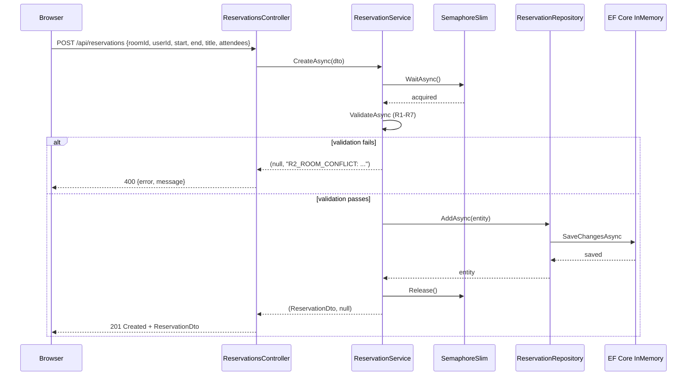
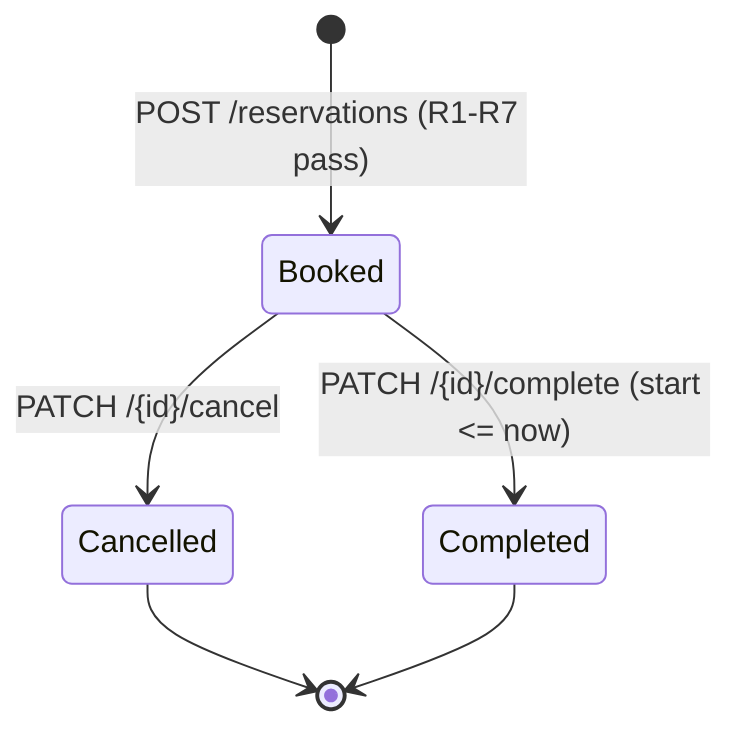

# Architecture

## Layer overview

```
Browser (React 18 + Vite + Tailwind)
  |
  | HTTP /api  (Vite proxy -> localhost:5000)
  v
ASP.NET Core 8 Web API
  |-- Controllers      (HTTP in/out, error mapping)
  |-- Services         (validation + business logic, returns (dto, error) tuples)
  |-- Repositories     (EF Core queries, IRepository<T> abstraction)
  |-- Data             (AppDbContext, DbSeeder)
  |-- Models           (Room, User, Reservation, ReservationStatus)
  |-- DTOs             (request/response shapes)
  |-- Mappers          (entity <-> DTO conversion)
  |-- Options          (ReservationOptions, bound from appsettings.json)
```

## Request sequence -- create a reservation



## Reservation state lifecycle



Cancelled reservations free the time slot for new bookings. Completing a reservation records `ActualEndTime = min(now, EndTime)` and likewise releases the slot for bookings starting after `ActualEndTime`.

## Validation strategy -- R1-R7

All seven booking rules live in a single `ValidateAsync` method in `ReservationService`. Controllers never duplicate business logic; they only map the returned error string to an HTTP status.

| Code | Check |
|---|---|
| R1_MAX_DURATION | start < end AND (end - start) <= MaxDurationDays |
| R2_ROOM_CONFLICT | no Booked reservation for the same room overlaps [start, end) |
| R3_ORGANIZER_CONFLICT | no Booked reservation for the same user overlaps [start, end) |
| R4_FUTURE_ONLY | start > UtcNow |
| R5_CAPACITY_EXCEEDED | attendeesCount <= room.Capacity |
| R6_BOOKING_HORIZON | start <= UtcNow + MaxBookingHorizonDays |
| R7_ROOM_INACTIVE | room.IsActive == true |

`MaxDurationDays` (7) and `MaxBookingHorizonDays` (90) are read from `appsettings.json` via `IOptions<ReservationOptions>`.

Overlap check uses a half-open interval: two bookings A and B conflict when `A.Start < B.End && B.Start < A.End`. This means adjacent bookings (A ends exactly when B starts) do not conflict, which matches the intuition that a room is free the moment the previous meeting ends.

## Concurrency model

```csharp
private static readonly SemaphoreSlim _writeLock = new(1, 1);
```

A **static** semaphore serialises `CreateAsync`, `UpdateAsync`, `CancelAsync`, and `CompleteAsync` within a single process. Every write operation acquires the lock, validates, writes, then releases.

**Scope**: this prevents double-bookings inside one running instance. It does not protect across multiple processes or hosts (see [KNOWN_LIMITATIONS.md](KNOWN_LIMITATIONS.md)).

## Error format

Services return `(dto, error)` tuples. When `error` is non-null it has the form `"CODE: human message"`. Controllers split on `':'` with `Split(':', 2)` and return:

```json
{ "error": "CODE", "message": "human message" }
```

HTTP status is derived from the code prefix: `_NOT_FOUND` codes become 404, everything else becomes 400.

## Persistence

EF Core InMemory provider, database named `"RoomReservationDb"`. The database is seeded on first call to `DbSeeder.SeedAsync`:

- 5 rooms across three floors (capacities 4-30, various amenity combinations)
- 3 users
- 2 sample reservations

**Data does not persist across restarts.** This is intentional per task scope (see [DECISIONS.md](DECISIONS.md) ADR-02).

## Test coverage

19 xUnit tests in `ReservationValidationTests`. Each test creates a fresh InMemory database via `Guid.NewGuid()` to avoid cross-test interference.

| Area | Tests |
|---|---|
| R1-R7 validation rules | 7 |
| R1 boundary (exact max, one over) | 2 |
| R6 boundary (exact horizon, one over) | 2 |
| Happy path create | 1 |
| Cancel lifecycle | 1 |
| Cancelled slot rebooking | 1 |
| Complete before start | 1 |
| Complete in-progress, ActualEndTime set | 1 |
| Floor filter case-insensitivity | 1 |
| Early completion + rebook | 1 |
| **Total** | **19** |
